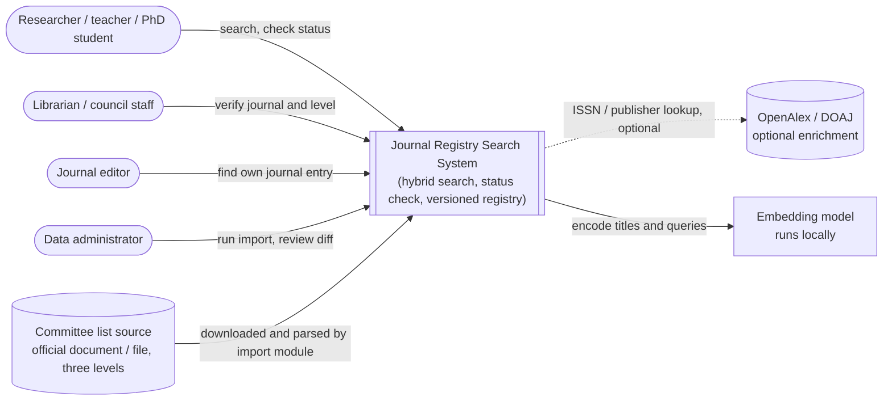
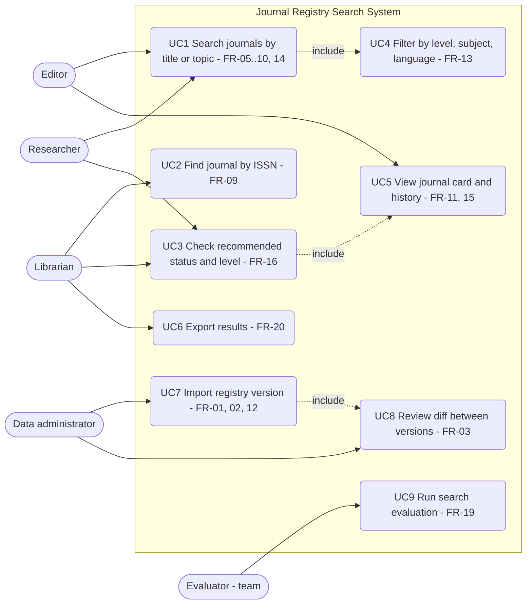
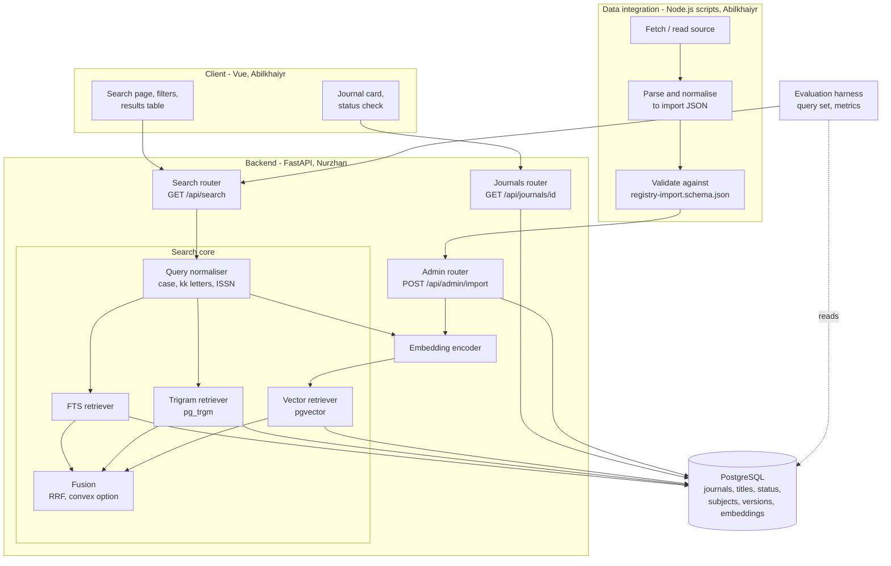
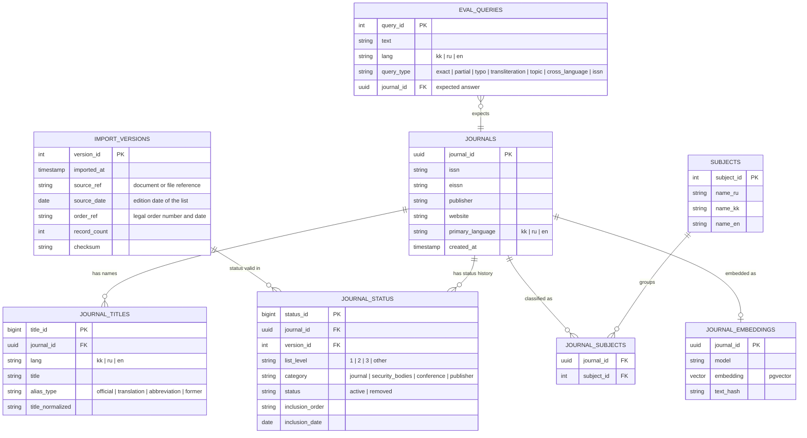
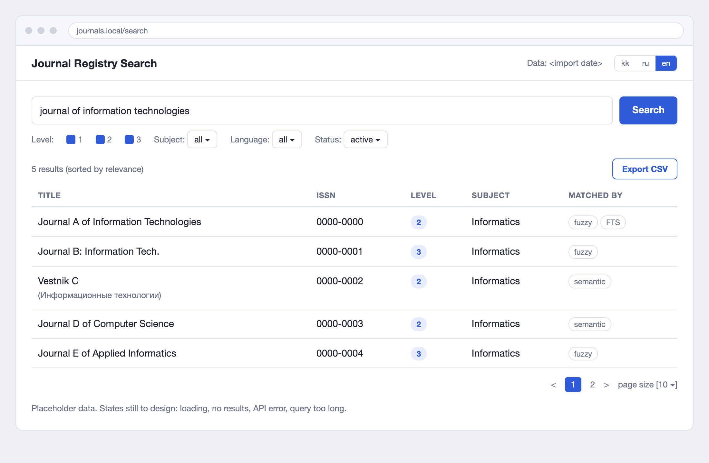
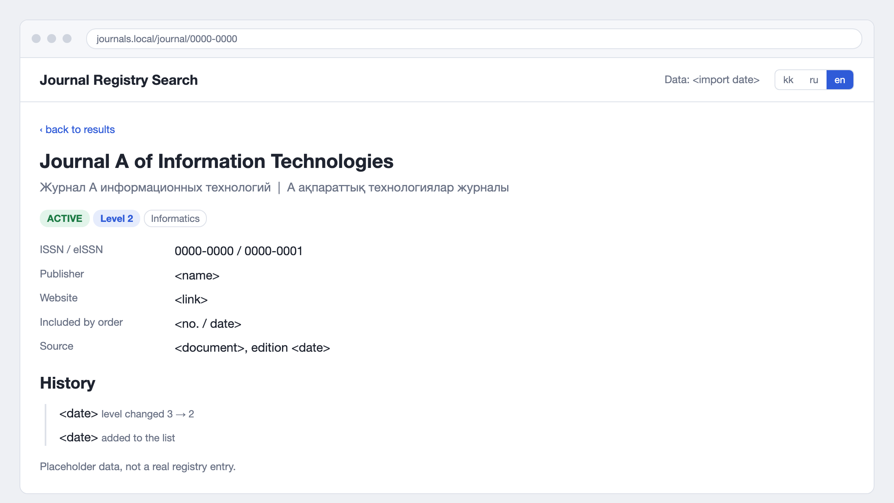
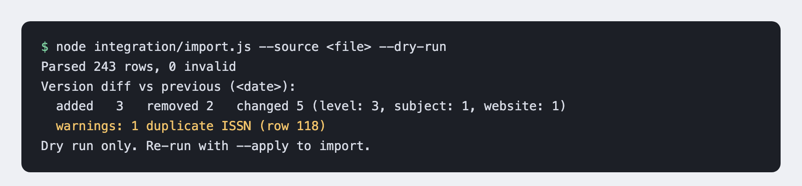

# Intelligent System for Indexing Academic Journals Recommended by the Committee (КОКСНВО МНВО РК)
## Diploma project: analysis and design report (pre-defense 1, 24 October 2026)

Team: Nurzhan Izimbetov (Backend & Search Core), Abilkhaiyr Sarsenbay (Frontend & Data Integration), group SE-2421. Supervisor: Symbat Nurgaliyeva, PhD. Repository: https://github.com/nurzhqn0/indexing-system

**Project definition.** The core of the diploma is a web system for searching the Committee's list of recommended journals: hybrid retrieval (full-text, fuzzy and semantic search fused by Reciprocal Rank Fusion), a status check, a versioned registry, a Vue frontend and a FastAPI backend with PostgreSQL. This follows the supervisor's justification.


| # | Component | Where |
|---|---|---|
| 1 | Project proposal | [Section 1](#1-project-proposal) |
| 2 | Evidence of relevance | [Section 2](#2-evidence-of-relevance) |
| 3 | Literature review | [Section 3](#3-literature-review) |
| 4 | Existing system comparison | [Section 4](#4-existing-system-comparison) |
| 5 | Technology comparison | [Section 5](#5-technology-comparison) |
| 6 | Requirements specification | [Section 6](#6-requirements-specification) |
| 7 | Architecture and diagrams | [Section 7](#7-architecture-and-diagrams) |
| 8 | UX / prototype | [Section 8](#8-ux-and-prototype) |
| 9 | Verification and evaluation plan | [Section 9](#9-verification-and-evaluation-plan) |
| 10 | Project management and risks | [Section 10](#10-project-management-and-risks) |
| 11 | Supervisor feedback | [Section 11](#11-supervisor-feedback) |
| A-E | Appendices: search log, ADRs, abbreviations, task list, API examples | [A](#appendix-a-literature-search-log), [B](#appendix-b-architecture-decision-records), [C](#appendix-c-abbreviations), [D](#appendix-d-youtrack-task-list-import-ready), [E](#appendix-e-api-examples-planned) |
| - | References (APA 7th edition) | [References](#references) |

Sources of material: the supervisor's justification (roles, plan), the Committee's list file (edition of 15 Sep 2026), `docs/lit/references.bib`, diagrams in `diagrams/`.

---

# 1. Project Proposal

## Title
**EN:** Development of an Intelligent System for Indexing Academic Journals Recommended by the Science and Higher Education Quality Assurance Committee of the Ministry of Science and Higher Education of the Republic of Kazakhstan

**RU:** Разработка интеллектуальной системы индексации научных журналов, рекомендованных Комитетом по обеспечению качества в сфере науки и высшего образования Министерства науки и высшего образования РК

**KZ:** ҚР Ғылым және жоғары білім министрлігінің сапаны қамтамасыз ету комитеті ұсынған ғылыми журналдарды индекстеуге арналған интеллектуалды жүйесін әзірлеу

## Team
| Role | Name | Group | Responsibility (from the supervisor's justification) |
|---|---|---|---|
| Student | Nurzhan Izimbetov | SE-2421 | **Backend & Search Core Engineer**: server architecture, database, FastAPI, hybrid search, fuzzy search, performance, containerisation and deployment |
| Student | Abilkhaiyr Sarsenbay | SE-2421 | **Frontend & Data Integration Engineer**: Vue frontend, search forms, tables, filters, journal cards, user scenarios, validation, error handling, preparation and synchronisation of registry data |
| Supervisor | Symbat Nurgaliyeva, PhD, assistant professor | | weekly meetings, code review, architecture and search-method consultation |

## Problem statement
Researchers, teachers and doctoral students in Kazakhstan must regularly check whether a journal is in the list of publications recommended by the Committee (КОКСНВО МНВО РК) for publishing the main results of scientific activity. The list is published as documents that are inconvenient to search, and it changes: it is updated regularly and was reorganised into three levels by the order of 3 June 2025 (section 2). Titles occur in Kazakh, Russian and English, with transliteration variants, abbreviations and typos. A user needs one tool that finds a journal quickly, even from an imperfect query, and shows its status, list level and subject area.

## Target users
| User | Need |
|---|---|
| Researchers, teachers, PhD students | check whether a journal is recommended and at which level before submitting |
| Librarians, dissertation-council staff | verify publication requirements quickly and consistently |
| Journal editors | see how their journal is listed |
| Ministry / Committee analysts (secondary) | browse the list by level, subject and language |

User needs come from the supervisor's justification and from the literature; they are **assumptions until confirmed** by the user survey and discussions (section 2.4).

## Aim
To design, implement, deploy and evaluate a web system that lets users search the Committee's list of recommended journals with hybrid retrieval (full-text, fuzzy and semantic search combined by Reciprocal Rank Fusion) across Kazakh, Russian and English queries, and shows journal status and metadata.

## Research question
Does hybrid retrieval, which combines PostgreSQL full-text search, trigram fuzzy matching and multilingual vector search through Reciprocal Rank Fusion, find the intended journal more reliably than each method alone for realistic trilingual queries (exact titles, partial titles, typos, transliteration, subject descriptions), while meeting an interactive latency target?

## Objectives
| # | Objective | Owner |
|---|---|---|
| O1 | Obtain, normalise and version the registry data (journals, ISSN, publisher, list level, subject, language, inclusion order and date) with a repeatable import | Abilkhaiyr (data), Nurzhan (schema) |
| O2 | Design and implement the backend: schema, FastAPI with documented endpoints, import endpoint | Nurzhan |
| O3 | Implement and tune the search core: FTS, trigram fuzzy search, vector search, RRF fusion | Nurzhan |
| O4 | Implement the Vue frontend: search, filters, tables, journal card, status check, validation, error handling | Abilkhaiyr |
| O5 | Build the evaluation set and measure relevance and speed against single-method baselines | Nurzhan (search side), Abilkhaiyr (query set, UI checks) |
| O6 | Containerise and deploy the system; write documentation and tests | both |


## Expected outcomes
- Deployed web service with documented API and relevant, fast search over the registry.
- Versioned registry database and repeatable import and update module.
- Vue interface with search, filtering, journal pages and status check.
- Evaluation report: relevance and latency of hybrid versus baselines, per language and query type.
- Documentation, tests, container setup.

## Scope
**In scope**
- Journals of the Committee's list: the whole file is imported (Lists 1, 2, 3 and the list of military and security university journals, 243 rows in the edition of 15 Sep 2026). **The product and its evaluation focus on the IT and computer-science (IT/CS) subset**: 15 journals selected from Lists 1 and 2 by subject area (section 2.6). Fields in the file: title (kk, ru or en, often mixed in one cell), publisher, scientific direction, inclusion date, order number and date. ISSN, language and website are **not in the file** and come from enrichment (OpenAlex, DOAJ, journal sites) or manual entry.
- Search: exact, partial, fuzzy, semantic; filters; status check.
- Import and update of registry data with change tracking.
- Deployment with Docker.

**Out of scope**
- Making or changing official accreditation decisions.
- Full article-level indexing, citation analysis.
- Automatic indexing of the thousands of international journals that enter List 1 automatically through Web of Science and Scopus. They are covered only by a rule note unless a legally usable list is obtained.
- Authentication and user accounts beyond a simple admin import key.


## Engineering complexity
- Data engineering: unknown and changing source format, normalisation of multilingual titles, ISSN validation, versioned imports with diff.
- Information retrieval: three retrieval methods and a fusion layer, tuned and evaluated on a purpose-built query set; multilingual (kk/ru/en) with limited tooling for Kazakh.
- Backend: PostgreSQL with FTS, `pg_trgm` and `pgvector` indexes, embedding service, API design, latency optimisation, containerised deployment.
- Frontend: responsive search interface with filters, tables, error and status handling, integrated with the API.
- Evaluation methodology: query set generation, relevance judgements, statistical comparison.


---

# 2. Evidence of Relevance


## 2.1 Documentary evidence about the list (secondary sources, to be verified against the official order)
| Finding | Source | Status |
|---|---|---|
| Requirements for recommended journals were rewritten by the order of the Minister of Science and Higher Education of 3 June 2025, in force from 21 June 2025 | [zakon.kz, 11 Jun 2025](https://www.zakon.kz/pravo/6480512-izmenilis-trebovaniya-k-nauchnym-izdaniyam-i-publikatsiyam.html) | news report; order text on adilet.zan.kz not yet read by us |
| The list has six components: scientific journals of level 1, 2 and 3; journals of security and law-enforcement bodies; proceedings of international conferences; list of trusted Kazakhstani publishers | same | secondary |
| List 1 includes all Web of Science Core Collection and Scopus journals automatically, plus listed trusted publishers; domestic List 1 journals need DOI for each article, IMRAD structure, blind review, licensed plagiarism check | same | secondary |
| A commercial guide gives counts "as of July 2026": List 1 46 domestic journals (plus thousands of international titles), List 2 164, List 3 19, and states the list is updated quarterly | [a-articles.kz](https://a-articles.kz/perechen-koksnvo-mnvo-rk-spisok-1-2-3/) | **unverified commercial source**, counts must be checked against the official file |
| A 2024 Committee presentation described the earlier list as 152 journals in 18 directions; 174 before 2021, 147 in 2021 | [Committee presentation](https://enic-kazakhstan.edu.kz/files/1701339600/1-prezentaciya-koksnvo-a-toybaev.pdf), via search summary | secondary |
| Experts estimated that at most 20% of previously included titles meet the new criteria | zakon.kz / search summary | secondary opinion |

Counts differ between sources and over time: the number of domestic journals changed between 2021 and 2026 and depends on the list level. A commercial guide gives 46 + 164 + 19 = 229; the official file of 15 Sep 2026 has 47 + 163 + 22 = 232 rows in Lists 1-3 (243 with the 11 military and security journals), see section 2.6.

What this means for the project:
- The data set is **small** (hundreds of rows, not millions), so the difficulty is not scale but quality of matching: multilingual, noisy queries, changing source, and trustworthy status information.
- The list **changes** (quarterly updates, criteria change), which justifies versioned imports and a visible "data last updated" date.
- The official publication format (file type, columns) is **not yet verified**. This is the main data risk (section 10).

## 2.2 Evidence about existing tools 
| Tool | What it offers | Source |
|---|---|---|
| Scopus Sources | free browse and search of sources by subject area, title, publisher or ISSN | [Elsevier support](https://www.elsevier.support/scopus/answer/how-do-i-use-the-scopus-sources-feature) |
| Web of Science Master Journal List | lookup by title, keyword or ISSN/eISSN; profile shows Core Collection indexes | [CASRAI guide summary](https://casrai.org/guides/web-of-science-master-journal-list) |
| Committee list | published as official documents/files; no search service found in our review | section 4 |
None of these tools answers "is this journal on the Kazakhstani Committee's list, at which level?" in one query across kk/ru/en. This is the practical gap of the project (details in section 4).

## 2.3 Evidence from literature (verified, see section 3)
- Cyrillic and regional material breaks tools built for English: vanilla GROBID reaches F1 0.06 on Cyrillic headers (L1), and parsers need target-language data (L2, L3). The import of the official list is therefore tested on Kazakh and Russian rows, not assumed to work.
- No single database covers regional journals (L14, L15) and post-Soviet journals are poorly covered by Scopus and Web of Science (L18); neighbouring countries built national indexes and selected lists (L17). A purpose-built registry of the Committee list fills a gap that the international sources leave.

## 2.4 User survey and follow-up discussions
The user needs are explored with an anonymous online survey (Google Forms) of potential users, followed by 3-5 short discussions with volunteers and the supervisor. Survey form: https://docs.google.com/forms/d/e/1FAIpQLScFAFdqwJFGHOFftV6nI4vmFLz6PFovjTx-XXTA9Z2oMPNAMA/viewform (English; kk and ru copies to follow). Until the responses are in, every user need in this report is an **assumption** (section 2.5).

**Design**
| Item | Plan |
|---|---|
| Target groups | researchers and teachers; PhD and master's students; librarians and dissertation-council staff; journal editors |
| Sample | at least 30 responses, with at least 5 from each of the two largest groups |
| Distribution | university and faculty chats, department mailing lists, supervisor's contacts |
| Languages | form in kk, ru and en (English version is live; kk and ru copies to follow) |
| Period | 24 Oct to 6 Nov 2026 (reminder after one week) |
| Privacy | anonymous: no names or e-mails in the form; a separate optional field for follow-up contact, stored outside the repository; no personal data committed |
| Use of results | counts and percentages per closed question; open answers coded into themes; every finding mapped to a requirement id (section 6); real search queries added to the evaluation set (section 9.2) |

**Questionnaire** (to paste into the form)
1. Your role (researcher/teacher, PhD student, master's student, librarian or council staff, editor, other).
2. Your field (IT and computer science, other technical, natural sciences, humanities and social sciences, medicine, other).
3. How often do you check whether a journal is on the Committee's list? (never, yearly, monthly, weekly or more)
4. Where do you check it today? (official file, university site, Scopus or Web of Science, search engine, colleagues, other)
5. How long does a typical check take? (under 1 minute, 1-5 minutes, more than 5 minutes)
6. Have you ever got a wrong or unclear answer about a journal's status? (yes/no; if yes, what happened)
7. What do you usually search by? (title, abbreviation, ISSN, publisher, topic; several allowed)
8. In which languages do you type journal names or topics? (kk, ru, en; several allowed)
9. Do you often make typos or use abbreviations or transliteration when searching? (never, sometimes, often)
10. Do you search for journals by topic, such as "journals on information security"? (never, sometimes, often)
11. What must the answer show? Rate 1-5 in a grid: status, list level (1/2/3), subject area, date of inclusion or removal, link to the official order, ISSN, website.
12. Would you trust the result without opening the official file? (yes, only if the source and date are shown, no)
13. Write one or two real queries you would type (title, ISSN or topic).
14. What is the most annoying part of checking journals now? (open text)
15. Optional: may we contact you for a 15-minute follow-up? (leave an address; it is not stored in the repository)

**Follow-up discussions** (3-5, 20 minutes each)
| # | Role | Why | Contact / date | Status |
|---|---|---|---|---|
| U1 | PhD student or young researcher | how status is checked today; typical queries | in progress | in progress |
| U2 | Teacher or researcher who publishes regularly | decision before submission; which attributes matter | in progress | in progress |
| U3 | Librarian or scientometrics specialist | verification routines, error cases, official sources | in progress | in progress |
| U4 | Dissertation council secretary or PhD office | which level is required for defence; proof needed | in progress | in progress |
| U5 | Supervisor (client proxy) | scope, data source, priorities | in progress | in progress |

Note template per discussion:
```
Interviewee role / org:      Date / format:
Key facts stated (verbatim where possible):
Example queries given (language):
Requirement implied (-> FR/NFR id in section 6):
Changes our assumptions? (which):
Follow-ups:
```

**Results** (the form is open and the discussions are in progress; results are filled after the form closes on 6 Nov 2026, no figures are reported before that)
| Question | Result | Requirement affected |
|---|---|---|
| number of responses, group mix | in progress | |
| Q3-Q6: frequency, tools, time, errors | in progress | FR-16, NFR-01 |
| Q7-Q9: search by, languages, typos | in progress | FR-05 to FR-09 |
| Q10: topic search | in progress | FR-07 |
| Q11: fields the answer must show | in progress | FR-04, FR-14 |
| Q12: trust and source display | in progress | FR-16 |

## 2.5 Verified findings versus assumptions
| Statement | Status | Basis | How to verify |
|---|---|---|---|
| The 2025 order created three list levels | Reported by news source | zakon.kz | read order text on adilet.zan.kz |
| About 229 domestic journals in lists 1-3 | **Checked** against the file: 232 rows in lists 1-3 (47 / 163 / 22) plus 11 in list 4; commercial counts are close but outdated | official file of 15 Sep 2026 | re-count when a new edition appears |
| The list is updated quarterly | **Unverified** | a-articles.kz | check official file history |
| Scopus and WoS offer title/ISSN search but not the Committee status | Verified for the tools' own search features | vendor documentation | try both with sample journals |
| Researchers find the list inconvenient to search | Assumption (supervisor's justification) | none yet | survey Q3-Q6 and discussions U1-U4 (section 2.4) |
| Users query in kk, ru and en with typos and abbreviations | Assumption | none yet | survey Q7-Q9, Q13 |
| Hybrid retrieval beats single methods on this data | **Hypothesis** | no direct evidence for short multilingual journal titles; to be measured | evaluation in section 9 |
| Data file is machine-readable | **Verified** for the edition of 15 Sep 2026 (xlsx, one sheet per list, merged header text, no ISSN column) | the list file | confirm that the Committee publishes xlsx regularly (DIP-9) |

## 2.6 Analysis of available data: the official list file
Source: the Committee's list file "КОКСНВО от 15 сентября 2026 г." (xlsx, sheets for Lists 1, 2, 3, list 4 for military and security university journals, and the team's IT/CS selection).

| Sheet | Rows with a journal | Rows whose direction mentions IT, computer science, informatics or mathematics (rough keyword match) |
|---|---|---|
| List 1 | 47 | 13 |
| List 2 | 163 | 14 |
| List 3 | 22 | 1 |
| List 4 (military, security) | 11 | 0 |
| **Total** | **243** | |

**Columns:** order number, title, publisher, scientific direction, date or issue from which the journal is in the list, order date and number. There is no ISSN, language, website or status column.

**Irregularities found for the import module (FR-01, FR-02):**
- Sheet text, headers and subjects are mostly in Kazakh; titles mix Kazakh, Russian and English in one cell, sometimes with a former title ("бұрыңғы атауы").
- Numbers are stored as text or floats ("13.0", "45."); rows are not sorted; blank rows and a row split across two lines occur (journal 110).
- Inclusion cells use free text ("наурыз 2021 жыл", "2026 жылғы қаңтар айынан бастап"), and one cell can hold several orders (a journal added in 2024 and amended in 2025).
- Subject is free text with many comma-separated directions, not a controlled vocabulary.
- One IT/CS row (ҚазТБУ Хабаршысы) has no number.

**IT/CS subset (15 journals).** Selected by direction containing computer science, information and communication technologies, informatics, or automation and IT:

| # in file | Journal | Publisher | Level |
|---|---|---|---|
| 13 | Eurasian Journal of Mathematical and Computer Applications | L.N. Gumilyov ENU | 1 |
| 45 | Herald of the Kazakh-British Technical University | KBTU | 1 |
| 23 | Bulletin of the L.N. Gumilyov ENU, Mathematics, Computer Science | L.N. Gumilyov ENU | 2 |
| 38 | Bulletin of the National Engineering Academy of the RK | National Engineering Academy | 2 |
| 42 | Academic Scientific Journal of Computer Science Kazakhstan | Central Asia Academic Scientific Center LLP | 2 |
| 54 | Proceedings of the University (Karaganda Technical University) | KTU | 2 |
| 135 | Journal of Problems in Computer Science and Information Technologies | Al-Farabi KazNU | 2 |
| 136 | Bulletin of the Civil Aviation Academy | Civil Aviation Academy | 2 |
| 48 | Bulletin of Abai KazNPU, Physics-Mathematics | Abai KazNPU | 2 |
| 85 | Scientific Journal of Astana IT University | Astana IT University | 2 |
| - | Bulletin of Kazakh University of Technology and Business (ҚазТБУ) | KazUTB | 2 |
| 110 | Bulletin of Shakarim University, Technical Sciences | Shakarim University | 2 |
| 111 | Bulletin of the M. Tynyshpayev Kazakh Academy of Transport and Communications | KazATC | 2 |
| 139 | International Journal of Information and Communication Technologies | International IT University | 2 |
| 155 | EKTU Journal of Information and Communication Sciences | D. Serikbayev EKTU | 2 |

Levels were read by matching titles to the list sheets (journals 13 and 45 are in List 1, the others in List 2); re-check them in the import test (DIP-9). Titles are translated for readability; the file keeps the original.

**Consequences for the design:**
1. ISSN lookup (FR-09) needs a second source. The core fields come from the file; ISSN and eISSN are added by an enrichment step (OpenAlex or DOAJ API, journal sites) and by manual entry, with a flag showing where each value came from.
2. The evaluation set (section 9) has two parts: the full registry (243 rows) for title, typo and cross-language queries, and the IT/CS subset for topic queries ("journals on machine learning", "cybersecurity"), where semantic search should help most.
3. Subject strings must be normalised into a small controlled list before topic filters work.

---

# 3. Literature Review

Requirement: at least 12 meaningfully used sources, at least 8 scientific, mostly from the last five years, with foundational works kept. This review has 18 sources: 11 open-access papers selected by a structured database search (L1-L11, search log in Appendix A) and 7 added in October 2026 by targeted web search (L12-L18, bibliographic data checked against DOI, publisher or arXiv pages). 17 are scientific and 1 is a tool paper (L12). 11 are from 2021 or later. Full BibTeX: [lit/references.bib](lit/references.bib).

The review asks what published work says about three things the system depends on: (1) reading metadata and lists in Cyrillic and other non-English scholarly material, (2) how scholarly indexes and journal lists are built and how far they cover regional journals, and (3) which text models suit scientific and multilingual text.

## 3.1 Source table
| # | Source | Year | Type | Focus | Used for |
|---|---|---|---|---|---|
| L1 | Krause, Shapiro, Saier, Färber, SDP workshop (ACL) | 2021 | scientific | metadata extraction on Cyrillic PDFs | evidence that Western tools fail on Cyrillic; import risk |
| L2 | Choi, Yoon, Hyun, Lee, PLOS ONE | 2023 | scientific | multilingual reference corpus, BERT-REF | multilingual parsing, annotation quality |
| L3 | Kong, Yoon, Seol, Lee, Choi, IEEE Access | 2023 | scientific | Korean journals, text plus 2D boxes | national-corpus approach, layout features |
| L4 | Lo, Wang, Neumann, Kinney, Weld, ACL (S2ORC) | 2020 | scientific, foundational | open full-text corpus pipeline | modular ingestion pattern |
| L5 | Nicholson et al., Quantitative Science Studies (scite) | 2021 | scientific | citation index at production scale | how an index is built from extracted data |
| L6 | Choi, Kong, Yoon, Computers, Materials & Continua (LAME) | 2022 | scientific | layout-aware metadata extraction | layout features across journal templates |
| L7 | Alyafeai, Al-Shaibani, Ghanem, Findings of EMNLP (MOLE) | 2025 | scientific | LLM metadata extraction | LLM option for irregular tables |
| L8 | Blecher, Cucurull, Scialom, Stojnic, ICLR 2024 / arXiv (Nougat) | 2023 | scientific | vision-based document parsing | heavy alternative, rejected |
| L9 | Cohan, Feldman, Beltagy, Downey, Weld, ACL (SPECTER) | 2020 | scientific, foundational | citation-informed document embeddings | embeddings for journal and topic text |
| L10 | Saier, Krause, Färber, JCDL (unarXive 2022) | 2023 | scientific | full text linked to OpenAlex | linking records to an open graph |
| L11 | Beltagy, Lo, Cohan, EMNLP (SciBERT) | 2019 | scientific, foundational | scientific vocabulary | domain language models |
| L12 | Lopez, ECDL (GROBID) | 2009 | tool paper | CRF header and reference extraction | baseline parser |
| L13 | Tkaczyk et al., IJDAR (CERMINE) | 2015 | scientific | born-digital PDF metadata, average F-score 77.5% | second baseline parser |
| L14 | Visser, van Eck, Waltman, Quantitative Science Studies | 2021 | scientific | Scopus, Web of Science, Dimensions, Crossref, Microsoft Academic compared | coverage limits of databases |
| L15 | Martín-Martín, Thelwall, Orduna-Malea, Delgado López-Cózar, Scientometrics | 2021 | scientific | citation coverage of six databases | why one database cannot answer a national-list question |
| L16 | Priem, Piwowar, Orr, arXiv (OpenAlex) | 2022 | scientific (preprint) | open index of works, venues, institutions | optional enrichment of journal records |
| L17 | Moskaleva, Pislyakov, Sterligov, Akoev, Shabanova, Scientometrics (Russian Index of Science Citation) | 2018 | scientific | national citation index and journal selection in a neighbouring country | analogue of a national list |
| L18 | Study of post-Soviet countries in Scopus and Web of Science, European Science Editing 46, e53192 (doi 10.3897/ese.2020.e53192) | 2020 | scientific | coverage of post-Soviet journals in the two international indexes | regional coverage gap; **authors to be added from the DOI page** |

## 3.2 Structured analysis of the core publications (L1-L11)
Metrics are as reported by the authors; we did not reproduce them.

| Source | Research problem | Research method | Dataset / sample | Technology or approach | Evaluation metrics | Main findings | Reported limitations |
|---|---|---|---|---|---|---|---|
| L1 Krause, Shapiro, Saier, & Färber (2021) | Off-the-shelf scholarly metadata extractors (vanilla GROBID) are trained on English/Latin typography and experience severe performance collapse when processing Cyrillic academic PDFs. | Weakly supervised bootstrapping pipeline combining heuristic rules, character n-gram language detection, pdftotext spatial stream extraction, and deep sequence labeling. | 15,553 Cyrillic open-access academic publications from CORE collection across Ukrainian (11,708), Russian (3,786), and Bulgarian (54). | pdftotext spatial stream extraction, BiLSTM sequence tagging with fastText embeddings, and retrained GROBID (CRF). | Precision, Recall, Macro and Micro F1-score across header metadata fields (Title, Author, Misc). | Vanilla GROBID achieved an F1 of only 0.06 on Cyrillic headers; retrained GROBID improved F1 to 0.83; standalone BiLSTM achieved F1 = 0.90 (precision 0.88, recall 0.91). | Does not explicitly address 2D visual layout coordinates; requires clean digital text layers and fails on scanned bitmap PDFs. |
| L2 Choi, Yoon, Hyun, & Lee (2023) | Standard reference parsers (GROBID, CERMINE) are limited to English references and fail to extract diverse non-Western metadata fields from multilingual reference lists. | Corpus construction with rigorous annotation guidelines followed by transfer learning using BERT-based sequence labeling (BERT-REF). | 3,815,987 multilingual references (mainly English and Korean) labeled across 13 distinct bibliographic metadata fields. | BERT-based transfer learning token classification (BERT-REF) trained on BIO-tagged sequences, benchmarked against GROBID. | Token-level and entity-level Precision, Recall, and F1-score; inter-annotator agreement kappa. | BERT-REF achieved 99.83% token F1 score across 13 reference fields; high inter-annotator agreement (kappa = 0.941), significantly outperforming vanilla GROBID on multilingual references. | Performance drops on references with non-standard abbreviations, irregular punctuation delimiters, or unindexed regional conference proceedings. |
| L3 Kong, Yoon, Seol, Lee, & Choi (2023) | Scarcity of open annotated academic corpora for national research ecosystems and inability of conventional text-only parsers to utilize 2D spatial layouts of academic article headers. | Large-scale automated corpus construction followed by fine-tuning domain-adapted BERT integrated with 2D spatial bounding-box coordinates. | 315,320 PDF papers belonging to 503 Korean academic journals across 12 metadata types. | SciBERT-ME-J model combining text tokens with 2D bounding-box spatial coordinates (x0, y0, x1, y1) extracted via PDFMiner. | Field-level F1-score, Precision, and Recall on Title, Author, Affiliation, Abstract, and Keywords; inference latency. | SciBERT-ME-J achieved an outstanding F1 score of 99.36% on header metadata extraction, demonstrating that 2D layout coordinates prevent column reading-order errors. | Manual inspection was required for test sets; extraction accuracy drops on papers deviating from standard journal layout templates. |
| L4 Lo, Wang, Neumann, Kinney, & Weld (2020) | Fragmented, proprietary, and paywalled scholarly corpora lacking structured full-text, resolved citation links, and open machine-readable formats for downstream NLP tasks. | Large-scale distributed automated ingestion, normalization, PDF-to-TEI XML extraction using customized parser pipeline, and citation graph resolution. | S2ORC corpus comprising 81.1 million English academic paper metadata records and 8.1 million full-text open-access papers. | Distributed pipeline integrating SCIENCEPARSE v3.0.0 and GROBID v0.5.5, parsing PDF into TEI XML/JSON with resolved inline citation links. | In-text citation linking precision and coverage, TEI XML parsing validity, multi-disciplinary corpus coverage. | Constructed the largest open research corpus with parsed inline citations, establishing modular pipeline architecture for scalable citation indexing. | Ingestion pipeline was designed strictly for English publications; extraction fails or exhibits high corruption rates on non-Latin fonts and non-standard national journal formats. |
| L5 Nicholson et al. (2021) | Traditional academic citation indices treat citations as flat, unweighted numerical counts, failing to provide context or distinguish between supporting, mentioning, or contrasting citations. | Large-scale deep learning classification pipeline built atop publisher PDF streams to extract in-text citation contexts and classify author intent. | Over 23 million full-text scientific articles and a production database of more than 800 million classified citation statements. | Extended GROBID engine for extracting citation sentences, coupled with deep learning neural classifier for tri-class intent classification (supporting, disputing, mentioning). | Classification precision, recall, and F1-score across citation context categories; citation parsing accuracy. | Demonstrated that context-aware smart citation indexing is operationally viable at massive scale (800M+ statements), providing qualitative depth to research evaluation. | Substantial compute overhead required for full-text processing; reliance on publisher PDF layout consistency; reduced accuracy when citation statements rely on complex multi-sentence argumentation. |
| L6 Choi, Kong, & Yoon (2022) | Diverse formatting and irregular multi-column layouts across journals disrupt standard left-to-right text parsers, conflating header metadata fields. | Development of LAME (LAyout-aware Metadata Extraction) framework integrating PDFMiner automatic layout analysis with pre-trained transformer modeling. | Large corpus of diverse academic journal articles with varying layout formats from domestic Korean publishers. | LAME framework equipped with PDFMiner 2D coordinate extraction and Layout-MetaBERT for layout-aware sequence modeling. | Macro-F1, Precision, and Recall across 5 core metadata fields (title, abstract, author name, affiliation, keywords). | Layout-MetaBERT achieved Macro-F1 = 93.27% across diverse layout formats, confirming that 2D layout features prevent field boundary confusion in multi-column formats. | High memory and GPU processing requirements; sensitive to irregular multi-column splits and floating author footers. |
| L7 Alyafeai, Al-Shaibani, & Ghanem (2025) | Manual annotation of scientific metadata cannot keep pace with the exponential growth of scholarly literature, while traditional rule-based tools lack generalizability. | MOLE framework leveraging Large Language Models (LLMs) with schema-driven prompting, multi-format processing, and automated validation loops. | Benchmark of 126 scientific papers across 3 formats (PDF, Markdown, text) evaluated on 32 distinct metadata attributes across 7 LLMs. | Prompt-engineered LLMs (open-weight and proprietary) with structured JSON decoding and self-consistency schema validation guards. | Schema compliance, exact match, attribute-level F1-score, and hallucination frequency. | Modern LLMs exhibit strong zero-shot extraction capability across multilingual documents (F1 > 0.90), but require schema validation to ensure consistency. | High inference latency and computational expense make LLMs impractical for million-paper batch ingestion without hybrid filtering; risk of hallucinated metadata if prompt constraints fail. |
| L8 Blecher, Cucurull, Scialom, & Stojnic (2023) | Programmatic PDF text layers frequently lose semantic information, scramble reading order, and corrupt mathematical expressions in scientific documents. | Visual document understanding paradigm treating academic document parsing as an end-to-end vision-to-sequence translation task without relying on underlying text layers. | 1,748,201 articles released on arXiv paired with LaTeX source files, plus PubMed Central open-access articles. | Nougat architecture: Swin Transformer base encoder (96 DPI raster input) + mBART decoder (10 layers, 350M parameters) generating Markdown/LaTeX. | Normalized Edit Distance, BLEU, and formula reconstruction accuracy. | Demonstrates high-fidelity parsing of complex scientific text and math formulas directly from page raster images, bypassing damaged font streams completely. | Autoregressive generation is computationally slow (several seconds per page); model can occasionally get stuck in repetitive token generation loops; requires GPU acceleration. |
| L9 Cohan, Feldman, Beltagy, Downey, & Weld (2020) | Standard BERT models produce suboptimal document-level embeddings because they only encode local text tokens without leveraging inter-document citation graph topology. | Citation-informed pre-training objective where paper embeddings are trained to pull cited papers closer and push non-cited papers further away in vector space. | 146K query papers (26.7M tokens) and 684K training triples with hard and easy negatives from Semantic Scholar. | SPECTER transformer encoder trained using triplet margin loss on citation links; requires no citation graph structure during inference. | Accuracy, MAP, and F1-score across the SCIDOCS evaluation benchmark (7 document-level tasks: classification, citation prediction, recommendation). | Consistently outperforms SciBERT and BERT baselines on all 7 SCIDOCS document-level tasks without task-specific fine-tuning; eliminates the need for graph inputs at inference time. | Effectiveness depends on dense citation networks, which may be sparse in emerging or localized regional research domains. |
| L10 Saier, Krause, & Färber (2023) | Existing scholarly full-text corpora suffer from limited domain and time coverage, incomplete citation networks, and lossy representation of mathematical notations. | Construction of unarXive 2022 via an automated pipeline pre-processing arXiv papers into structured full-text and linking citations to open knowledge graphs. | 1.9 million publications from arXiv across multiple scientific disciplines spanning 32 years (1991–2022). | Automated pipeline integrating LaTeXML and GROBID with persistent OpenAlex entity resolution. | In-text citation marker resolution rate, citation graph completeness, database query latency. | Successfully linked 64,547,944 in-text citation markers directly to OpenAlex, creating a complete open citation graph with structured full text and LaTeX math formulas. | Pipeline relies heavily on the presence of LaTeX source files in arXiv; pure PDF fallback parsing exhibits higher reference extraction error rates. |
| L11 Beltagy, Lo, & Cohan (2019) | General-domain BERT models exhibit only 42% token overlap with scientific terminology, causing substantial out-of-vocabulary errors on scholarly document processing tasks. | Pre-training a domain-specific BERT architecture from scratch using a specialized scientific vocabulary on a large corpus of scientific literature. | 1.14 million scientific papers (3.17 billion tokens; 18% computer science, 82% biomedical) from Semantic Scholar. | SciBERT: BERT-base architecture trained with custom 30K WordPiece vocabulary (SciVocab) built using SentencePiece. | F1-score across 8 benchmark NLP tasks: named entity recognition (NER), relation extraction, dependency parsing, text classification. | Consistently outperforms BERT-base across all 8 scientific NLP benchmarks (+2.5 to +4.0 F1); established that domain-specific vocabulary is foundational for scientific text processing. | Pretrained exclusively on English-language publications; lacks multilingual/Cyrillic tokens, requiring fine-tuning or adaptation for national non-Latin corpora. |

## 3.3 Added sources (L12-L18)
| Source | What it contributes | Limitation for this project |
|---|---|---|
| L12 Lopez 2009 | GROBID, the usual open baseline for header and reference extraction (CRF) | tool paper; trained on Latin-script data (see L1) |
| L13 Tkaczyk et al. 2015 | CERMINE, open-source extraction from born-digital PDFs, modular, average F-score 77.5% | English-oriented; older than the transformer methods in L2, L3, L6 |
| L14 Visser et al. 2021 | compares Scopus, Web of Science, Dimensions, Crossref and Microsoft Academic on document coverage over time, document types and disciplines, and on citation links; recommends broad coverage with flexible filters | studies 2008-2017 and article records, not journal lists |
| L15 Martín-Martín et al. 2021 | 3,073,351 citations to 2,515 highly cited documents across six sources: Google Scholar found about 88%, Microsoft Academic 60%, Dimensions 54%, COCI 28% | English-language, highly cited documents only |
| L16 Priem et al. 2022 | OpenAlex: open index (CC0) of 209M works, authors, venues, institutions; REST API and data dump | preprint; accuracy of venue and ISSN data for Kazakhstani journals not checked |
| L17 Moskaleva et al. 2018 | describes the Russian Index of Science Citation (launched 2005): about 25 million documents in the database, a Web of Science-hosted selection of 652 journals, citation contexts from full text of 4,391 journals | describes Russia, not Kazakhstan; figures are those of the paper and may be out of date |
| L18 European Science Editing 2020 | post-Soviet countries have low overall coverage in Scopus and Web of Science, with large differences between countries; most journals are not international | authors and exact figures to be read from the paper |

## 3.4 Critical synthesis
**What is known.**
1. Extraction tools trained on English fail on Cyrillic unless retrained: vanilla GROBID reaches F1 0.06 on Cyrillic headers and 0.83 to 0.90 after retraining (L1). Large annotated corpora in the target language lift reference parsing to above 99% token F1 (L2, L3). Layout features reduce field confusion on multi-column pages (L3, L6, agreeing).
2. LLM and vision-based extractors work without training but cost latency and compute, and need validation against hallucinated fields (L7, L8).
3. Production indexes are modular pipelines with entity linking to open metadata (L4, L5, L10), and open metadata sources such as OpenAlex can supply venue records (L10, L16).
4. No single database covers all journals: coverage differs strongly between Scopus, Web of Science, Dimensions, Google Scholar and open sources (L14, L15), and post-Soviet journals are poorly covered by the two international indexes (L18). Neighbouring countries solved this with national indexes and selected journal lists (L17).
5. Domain-specific text models beat general ones on scientific language (L11, L9), but the published ones are English-centred.

**Where the evidence is weak for this project.**
- The best numbers come from Korean or English corpora (L2, L3, L6) and are upper bounds for Kazakhstani material; Kazakh is absent from every study.
- Most work targets article-level extraction. The input here is a spreadsheet of about 240 journals (section 2.6), so the extraction literature mainly informs risk R1 and the design of the import step, not the core search.
- The coverage studies (L14, L15) compare databases of articles, not lists of journals approved by a regulator.

**Gap.** No work was found on a searchable registry of a national list of recommended journals, nor on status lookup against such a list for Kazakhstan. The nearest analogue is the Russian national index (L17), described by its operators. Absence in our queries is not proof of absence (Appendix A).

## 3.5 What the project takes from the literature
| Decision | Taken from |
|---|---|
| Treat the official list as semi-structured Cyrillic data: parse it with tested rules, keep a manual CSV fallback, and test on Cyrillic and Kazakh (risk R1) | L1, L2, L12, L13 |
| Use rule-based parsing first; consider an LLM with schema validation only for irregular rows, never as an unchecked step | L7 |
| Do not use a vision model (GPU, seconds per page) for a 240-row table | L8 |
| Store the registry as a versioned, linked metadata index with an enrichment step for ISSN and venue data (OpenAlex as optional source) | L4, L5, L10, L16 |
| Justify a purpose-built registry because no single database answers the Committee-list question | L14, L15, L18, L17 |
| Choose text models for scientific and multilingual text by testing on our own data, since published domain models are English-centred | L9, L11 |
| Report results per language and record the Kazakh gap | L1, L2, L3 |

## 3.6 Count
Scientific sources: 17 (L1-L11, L13-L18). Tool paper: 1 (L12). Total 18. From 2021 or later: 11 (L1, L2, L3, L5, L6, L7, L8, L10, L14, L15, L16).

---

# 4. Existing System Comparison

Five systems on nine criteria. Cells say **Yes / Partial / No / Not verified** with the evidence. "Not verified" means we found no source; it is not a negative claim. Evidence was gathered on 21 Oct 2026 from vendor documentation and search summaries; no tool was tried hands-on yet (action in A.5).

### 4.1 Systems
| ID | System | Type | Evidence |
|---|---|---|---|
| S1 | Committee list as published (legal-information systems and university copies) | official document, three levels | [Adilet](https://adilet.zan.kz/rus/docs/V1600013409), [prg.kz copy as of July 2024](https://prg.kz/Document/?doc_id=39197441), [zakon.kz](https://www.zakon.kz/pravo/6480512-izmenilis-trebovaniya-k-nauchnym-izdaniyam-i-publikatsiyam.html) |
| S2 | Scopus Sources | commercial source list, free browse | [Elsevier support](https://www.elsevier.support/scopus/answer/how-do-i-use-the-scopus-sources-feature) |
| S3 | Web of Science Master Journal List | commercial journal list, free lookup | [CASRAI guide summary](https://casrai.org/guides/web-of-science-master-journal-list) |
| S4 | DOAJ (Directory of Open Access Journals) | open directory with API | third-party API guides and a DOAJ test-site copy of its docs; v4 syntax not confirmed |
| S5 | OpenAlex Sources | open scholarly index, journals as "sources" | [OpenAlex docs](https://docs.openalex.org/api-entities/sources/filter-sources) |

### 4.2 Criteria
| ID | Criterion | Why it matters |
|---|---|---|
| C1 | Knows the Committee list status and level | the central question of the project |
| C2 | Search by title | basic need |
| C3 | Search by ISSN | precise lookup, handles renamed journals |
| C4 | Typo / fuzzy tolerance | users type imperfect names |
| C5 | Kazakh, Russian and English titles | local journals use all three |
| C6 | Semantic or topic search | "journals on information security" |
| C7 | Filters (level, subject, language) | narrowing results |
| C8 | Open API or downloadable data | integration, reproducibility |
| C9 | Update visibility (date, history) | the list changes |

### 4.3 Comparison
| Criterion | S1 Committee list | S2 Scopus Sources | S3 WoS MJL | S4 DOAJ | S5 OpenAlex Sources |
|---|---|---|---|---|---|
| C1 Committee status | **Yes**, it is the source. Levels 1-3 per the 2025 order | **Partial.** Scopus-indexed journals enter List 1 automatically, but Scopus does not show the Committee status | **Partial.** Same: WoS Core Collection journals enter List 1 automatically; no Committee status shown | **No** | **No** |
| C2 Title search | **Partial.** Document or table, text search depends on the viewer; no search service found | **Yes.** Title search | **Yes.** Title and keyword | **Yes** (free-text journal search per API guides) | **Yes.** `search` parameter |
| C3 ISSN search | **Partial.** Visible if ISSN is in the table | **Yes** | **Yes**, ISSN and eISSN | **Yes** (ISSN lookup per guides) | **Yes.** `issn_l` and `issn` filters (documented in reference and openalexR examples) |
| C4 Fuzzy / typo tolerance | **No** (document) | **Not verified** | **Not verified** | **Not verified** (Elasticsearch based, per docs syntax) | **Not verified** |
| C5 kk / ru / en | **Yes** for the titles as printed; no cross-language search | **Partial.** Titles as indexed, mostly Latin script | **Partial.** Same | **Partial.** Titles as supplied | **Partial.** Titles as supplied; Kazakh coverage not verified |
| C6 Semantic / topic search | **No** | **Partial.** Browse by subject area | **Partial.** Keyword lookup | **Partial.** Subject fields | **Partial.** Topic data exist; quality for this use not verified |
| C7 Filters | **Partial.** Level and subject are sections or columns, no interactive filter | **Yes.** Subject area and others | **Partial.** Not verified in detail | **Yes** (fields) | **Yes.** Many filters |
| C8 Open API / data | **Partial.** Legal text and files; machine-readable form not verified | **No** public API for this feature (not verified) | **No** (not verified) | **Yes**, public API, rate limits unclear | **Yes**, open API; CC0 licence reported in its API spec |
| C9 Update visibility | **Partial.** Edition date ("as of July 2024" on one copy); quarterly updates claimed by a commercial source | **Not verified** | **Not verified** | **Not verified** | **Not verified** |

### 4.4 Conclusions
1. The only authoritative source of status (S1) is a document, with no fuzzy, cross-language or semantic search found, and an update trail only by edition date.
2. The international tools (S2-S5) search titles and ISSNs well, but none reports the Kazakhstani Committee status, which is the question users ask.
3. Public APIs (S4, S5) could enrich records (ISSN, publisher), but are not a substitute.
4. A system that imports S1, normalises it, and adds typo-tolerant, multilingual and semantic search with a status answer fills a concrete gap.

### 4.5 Limits and next steps
- Most cells rely on documentation, not on our own trials. Before the pre-defense, run ten sample journals through S2, S3, S5 and the official file and record what each returns (task DIP-8).
- The official publication format for S1 is not yet verified. Search results show a legal-information-system document and university PDF copies (task DIP-9).
- Scopus and Web of Science were included only as search-feature comparisons; their data are licensed and are not a source for the system.

---

# 5. Technology Comparison

Core decisions are scored against the requirement ids in section 6 (FR-xx functional, NFR-xx non-functional). Scores: ++ strong fit, + fit, 0 neutral, - weak, -- unfit. Facts come from the documentation and papers cited in section 3; **speed and relevance of each option have not been measured yet**, so choices are provisional and are confirmed by the benchmarks in section 9. Decision records are in Appendix B.


### 5.1 Decision 1: retrieval strategy
| Criterion | A. FTS only | B. Vector only | C. Hybrid FTS + fuzzy + vector, fused by RRF |
|---|---|---|---|
| Exact and partial titles, ISSN (FR-05, FR-09) | ++ | - short proper nouns embed poorly | ++ |
| Typos and transliteration (FR-06) | -- stemming cannot fix typos | + embeddings tolerate some noise | ++ with trigram component |
| Topic and cross-language queries (FR-07) | -- | ++ multilingual models | ++ |
| Evidence for this project | 0 to be measured (baseline M1) | 0 to be measured (M4) | 0 to be measured (H1, H2, section 9) |
| Complexity and latency (NFR-02) | ++ | + embedding at query time | 0 three queries plus fusion |
| Explainability for users | ++ | - | + show which method matched |
**Decision:** C, with A, trigram-only and B kept as baselines; fusion by RRF (k = 60, configurable) plus a convex-combination variant as ablation. The supervisor's document also specifies hybrid FTS plus vector search with RRF (ADR-001).

### 5.2 Decision 2: search and storage engine
| Criterion | A. PostgreSQL (FTS + `pg_trgm` + `pgvector`) | B. Elasticsearch / OpenSearch | C. SQLite FTS5 + external vector index (FAISS) |
|---|---|---|---|
| One system for data and search (FR-04, FR-05-08) | ++ single database, one transaction for imports | 0 second system to sync | - two stores |
| FTS, fuzzy, vector all available (FR-05-07) | ++ built in or extensions (pg_trgm docs, pgvector docs) | ++ native | + FTS5 yes, fuzzy weak |
| Fit with registry size (hundreds of rows) | ++ exact vector scan is enough, HNSW optional | 0 heavier than needed | ++ |
| Versioned imports, relational history (FR-03) | ++ | - | + |
| Deployment effort (NFR-03) | + one container with extensions | - larger memory footprint | ++ |
| Fit with supervisor's document | ++ names PostgreSQL FTS and vector indexes | - | - |
| Kazakh text configuration | 0 no Kazakh stemmer in standard configs (to verify); use `simple` config plus trigram | 0 analyzers available, not verified | 0 |
**Decision:** A. With a few hundred rows an exact (unindexed) vector scan is fast, so HNSW is an optimisation to measure, not a requirement (pgvector docs: exact scan is fine for a few thousand rows). Revisit if the registry grows by orders of magnitude (ADR-002).

### 5.3 Decision 3: embedding model
| Criterion | A. BGE M3 | B. multilingual E5 small/base/large | C. Sentence-Transformers multilingual MiniLM family |
|---|---|---|---|
| Kazakh and Russian coverage | + 100+ languages claimed | + multilingual pre-training | 0 to verify for Kazakh |
| Model size / CPU latency (NFR-02) | - larger, to measure | ++ small and base are light | ++ lightest |
| Extra functions | ++ dense, sparse, multi-vector, long input | 0 dense only | 0 dense only |
| Licence, hosting | to check | to check | to check |
| Evidence on this task | none | none | none |
**Decision:** do not choose by reading. Evaluate A and B (small or base) on the query set of section 9 and keep the cheaper model if the gap is small. Kazakh quality is a stated risk (R3). (ADR-003)

### 5.4 Decision 4: backend framework
| Criterion | A. FastAPI | B. Django + DRF | C. Node.js + Express |
|---|---|---|---|
| Python ML and embedding stack (FR-07) | ++ same language | ++ | - separate service for embeddings |
| Automatic OpenAPI docs (FR-10, 11) | ++ built in | + add-on | - add-on |
| Async, performance (NFR-02) | ++ | 0 | + |
| Fit with supervisor's document | ++ | - | - |
| Team skill | ++ Nurzhan (FastAPI, PostgreSQL experience per justification) | + | ++ Abilkhaiyr |
**Decision:** A for the API and search. Node and Express stay as the client toolchain and as the data-integration scripts (below) (ADR-004).

### 5.5 Decision 5: data integration module
| Criterion | A. Node script normalises source to JSON, posts to API | B. Python importer inside the backend |
|---|---|---|
| Matches the role split (Frontend & Data Integration) | ++ | - |
| Shared validation with the database schema (FR-02) | 0 duplicated unless a JSON Schema is shared | ++ |
| Parsing of PDF or HTML list tables | + libraries exist in both ecosystems; source format unknown | + |
| Testing and reuse in evaluation | 0 | ++ |
**Decision:** A with a versioned JSON contract (`registry-import.schema.json`) that the API validates with Pydantic, so validation lives in one place. Fall back to B if the source needs Python-only tooling (ADR-005).

### 5.6 Decision 6: frontend
Vue 3 is chosen by the frontend owner. Alternatives considered: server-rendered pages (simpler, fewer interactions, weaker filters and table UX) and React. Decision: Vue 3 with a small component library or plain CSS; table with sorting, filter chips, pagination.

### 5.7 Summary
| Decision | Choice | Alternatives | Main reason |
|---|---|---|---|
| Retrieval strategy | hybrid FTS + trigram + vector, RRF | FTS only, vector only | covers exact, typo and semantic queries |
| Engine | PostgreSQL + pg_trgm + pgvector | Elasticsearch/OpenSearch, SQLite + FAISS | single system, small data, supervisor's plan |
| Embedding model | BGE M3 vs multilingual E5, decide by measurement | MiniLM family | Kazakh and Russian quality vs CPU cost |
| Backend | FastAPI | Django, Express | Python ML stack, OpenAPI |
| Data integration | Node scripts with shared JSON contract | Python importer | role split, one validation point |
| Frontend | Vue 3 | server-rendered, React | frontend owner's choice |

---

# 6. Requirements Specification

Priority: **M** must, **S** should, **C** could (MoSCoW without "won't"; see out of scope in section 1). Status: **Planned** unless stated. Objective ids O1-O6 are from section 1. Items marked (A) rest on assumptions about user needs that the discussions of section 2 must confirm.


### 6.1 Functional requirements
| ID | Requirement | Pri | Obj | Acceptance criterion |
|---|---|---|---|---|
| FR-01 | Import the registry source into normalised journal records through one repeatable command or endpoint | M | O1 | Importing the same source twice gives identical data and no duplicates; import log lists counts of added, changed, removed records |
| FR-02 | Validate records: required fields, ISSN format and check digit, duplicates, unknown list level | M | O1 | A test file with 20 seeded errors is rejected or flagged for all 20; errors are listed with row numbers |
| FR-03 | Keep each import as a version with date and source reference; show the diff between versions | M | O1 | After two imports with 3 known changes, the diff reports exactly those 3; the previous version stays retrievable |
| FR-04 | Store per journal: titles and aliases in kk, ru, en, ISSN, eISSN, publisher, list level, subject areas, languages, website, inclusion order and date, status | M | O2 | Schema migration creates all fields; sample record with kk, ru and en titles round-trips unchanged (UTF-8) |
| FR-05 | Full-text search over titles, aliases, publisher and subjects | M | O3 | Query of an exact title returns that journal at rank 1 for at least 95% of the evaluation set exact-title queries |
| FR-06 | Fuzzy search tolerant to typos and partial input (trigram similarity) | M | O3 | Typo queries with 1-2 edits reach Recall@5 of at least 0.90 (HS2 for the fuzzy component alone is reported, not required) |
| FR-07 | Semantic search using multilingual embeddings for topic and cross-language queries | M | O3 | Embeddings stored for every journal; topic queries return relevant journals per the evaluation judgements; cross-language set is reported per language |
| FR-08 | Fuse FTS, fuzzy and vector rankings with Reciprocal Rank Fusion; parameter k and method weights configurable | M | O3 | Switching `fusion=rrf|convex|off` through a config value changes the result as expected in a unit test |
| FR-09 | ISSN lookup with hyphen and case normalisation | M | O3 | `1234-5678`, `12345678`, `1234 5678` return the same journal; invalid ISSN returns a clear message |
| FR-10 | Search API `GET /api/search` with query, filters (level, subject, language, status), method selector, pagination | M | O2 | OpenAPI document describes all parameters; contract tests pass |
| FR-11 | Journal API `GET /api/journals/{id}` with status, level, history of changes and source version | M | O2 | Response includes every field of FR-04 and history entries for a journal that changed between versions |
| FR-12 | Import API protected by an admin key, with dry-run mode | M | O2 | Request without key returns 401; dry-run changes no data |
| FR-13 | Filters in the UI: level, subject, language, status | M | O4 | Each filter reduces the result list correctly on a test data set; filters combine |
| FR-14 | Search page with query box, results table, sorting, pagination | M | O4 | Typing a query shows results; table sorts by title and level; page size selectable |
| FR-15 | Journal card or detail page with all metadata and change history | M | O4 | Open from a result; all FR-04 fields visible |
| FR-16 | Status check: a clear answer "recommended / not found", level, as-of date, source reference, for a title or ISSN (A) | M | O4 | For 10 test journals with known status the UI answer matches; "not found" shows search suggestions |
| FR-17 | Input validation, loading, empty and error states in the UI | M | O4 | Empty query, too long query, API down and no results each show a specific message, no blank screen |
| FR-18 | Show data version date and source on every page | M | O4 | Footer or header shows date of current import |
| FR-19 | Evaluation harness: run a query set through each method (FTS, fuzzy, vector, hybrid variants) and write metrics | M | O5 | One command writes Recall@k, MRR, nDCG@10 and latency per method, language and query type to a report file |
| FR-20 | Export results as CSV (C) | C | O4 | CSV opens in a spreadsheet with correct Cyrillic text |
| FR-21 | Interface language switch kk / ru / en (A) | S | O4 | Labels switch language; search not affected |
| FR-22 | Optional anonymous query log for tuning, off by default | C | O5 | When off, nothing stored; when on, only query text and timestamp |

### 6.2 Non-functional requirements
| ID | Category | Requirement | Pri | Acceptance criterion |
|---|---|---|---|---|
| NFR-01 | Relevance | HS1 and HS2 targets met on the evaluation set | M | Report in section 9 shows MRR@10 and Recall@5 per method |
| NFR-02 | Performance | p95 search response at most 300 ms on the full registry on the deployment machine, warm cache | M | 100 queries, 5 repeats, p95 reported |
| NFR-03 | Deployability | `docker compose up` starts database, API and client from a clean checkout | M | Followed on a second machine by the other team member |
| NFR-04 | Security | No secrets in the repository; admin key from environment; parameterised SQL; inputs length-limited | M | Secret scan clean; test injecting SQL metacharacters returns normal results |
| NFR-05 | Data integrity and provenance | Every journal record links to the import version it came from | M | Query joins journal to version for all rows |
| NFR-06 | Usability | Results visible with at most 2 interactions; layout works on a phone-sized screen; keyboard navigable | S | 3 users complete 3 tasks (section 9); viewport check at 375 px |
| NFR-07 | Maintainability | Unit and integration tests run in one command; modules separated (import, search, API, UI) | S | Test command passes in CI or locally; coverage of the search module reported |
| NFR-08 | Reproducibility | Pinned dependencies, fixed evaluation set and random seeds, recorded model version | M | Two evaluation runs give identical metrics for the same data |
| NFR-09 | Privacy | No personal data stored beyond optional query text | M | Review of tables and logs |
| NFR-10 | Localisation | Correct handling of Kazakh letters (ә, ғ, қ, ң, ө, ұ, ү, һ, і), Cyrillic case folding and Latin transliteration | M | Test cases for each letter find the journal under both spellings |
| NFR-11 | Observability | Health endpoint and request logging with timing | S | `/health` returns 200; log lines contain duration |
| NFR-12 | Compatibility | Current Chrome, Firefox, Safari, Edge | S | Smoke test on each |

### 6.3 Traceability to objectives and hypotheses
| Objective | Requirements |
|---|---|
| O1 Registry data | FR-01, FR-02, FR-03, NFR-05 |
| O2 Backend | FR-04, FR-10, FR-11, FR-12, NFR-04, NFR-11 |
| O3 Search core | FR-05 to FR-09, NFR-02, NFR-10 |
| O4 Client | FR-13 to FR-18, FR-20, FR-21, NFR-06, NFR-12 |
| O5 Evaluation | FR-19, FR-22, NFR-01, NFR-02, NFR-08 |
| O6 Deployment and quality | NFR-03, NFR-07, NFR-09 |
| HS1, HS2 | FR-19, NFR-01 |
| HS3 | NFR-02 |

### 6.4 Assumptions and dependencies
- The registry source can be obtained and parsed (section 10, risk R1).
- List levels and criteria follow the 2025 order; changes are handled by versioned import.
- Thresholds are targets, revised with the supervisor if the first baseline run shows them unrealistic, never after seeing final results.

---

# 7. Architecture and Diagrams

Readable SVG exports are in `diagrams/exports/`. Editable Mermaid sources: `diagrams/context.mmd`, `diagrams/usecase.mmd`, `diagrams/component.mmd`, `diagrams/erd_registry.mermaid`. GitHub renders the code blocks below; the files are the source of truth.


### 7.1 System context


External elements: the Committee list source (an official document or file; its exact format is still to be verified), an embedding model that runs locally, and optional public APIs (OpenAlex, DOAJ) for enrichment. Users do not log in; only the data administrator uses a protected import endpoint.

### 7.2 Use cases


### 7.3 Component diagram (draft)


| Component | Responsibility | Owner | Technology | Requirements |
|---|---|---|---|---|
| Vue frontend | search page, filters, results table, journal card, status check, validation and error states | Abilkhaiyr | Vue, HTML/CSS | FR-13 to 18, 20, 21 |
| Data integration | read the official source, parse, normalise to import JSON, validate, call import API, show diff summary | Abilkhaiyr | Node.js scripts, JSON Schema | FR-01 to 03 |
| Import router | accept import JSON, dry-run, write version and records, trigger embedding | Nurzhan | FastAPI, Pydantic | FR-01, 03, 12 |
| Query normaliser | case folding, Kazakh letters, ISSN normalisation, trimming | Nurzhan | Python | FR-09, NFR-10 |
| FTS retriever | full-text ranking over titles, aliases, publisher, subjects | Nurzhan | PostgreSQL FTS (`tsvector`, GIN) | FR-05 |
| Trigram retriever | typo-tolerant title matching | Nurzhan | `pg_trgm`, GIN index | FR-06 |
| Vector retriever | semantic neighbours of the query embedding | Nurzhan | `pgvector`, exact scan or HNSW | FR-07 |
| Fusion | combine three ranked lists, RRF (k = 60) and convex option | Nurzhan | Python | FR-08 |
| Search and journal routers | public API, filters, pagination, OpenAPI | Nurzhan | FastAPI | FR-10, 11 |
| Evaluation harness | run query set per method, compute metrics and latency | Nurzhan with Abilkhaiyr's query set | Python | FR-19 |
| Deployment | database, API and client in containers | Nurzhan | Docker Compose | NFR-03 |

### 7.4 Data model


The ERD is a design; no registry schema exists in code yet. Journals are separated from their status per import version, so a journal can change level or be removed without losing history. Titles live in their own table, one row per language and alias, which supports cross-language matching and abbreviations. Evaluation queries are stored with the expected journal.

### 7.5 Search design
1. **Normalise** the query: Unicode NFKC, lower case, Kazakh and Russian letter variants, remove punctuation, detect ISSN pattern (an ISSN query bypasses fusion and does an exact lookup).
2. **Retrieve** three ranked lists (top 50 each): FTS over titles and aliases (`simple` configuration plus language-specific variants where available), trigram similarity over normalised titles, vector similarity between query embedding and journal embedding (built from titles in all languages plus subject names).
3. **Fuse** with RRF: score(d) = sum over lists of 1 / (k + rank_list(d)), k = 60 by default. Ablation: convex combination of normalised scores with one weight tuned on a development split of the query set.
4. **Return** top N with the matching method per result, filters applied before ranking.
5. **Index choices:** GIN on `tsvector` and on `gin_trgm_ops`; vector column with exact scan first, HNSW added only if measurements show a need (registry has hundreds of rows).

### 7.6 API sketch
| Endpoint | Purpose |
|---|---|
| `GET /api/search?q=&level=&subject=&lang=&status=&method=hybrid&page=` | ranked journals, `method` in `fts|trgm|vector|hybrid` for evaluation |
| `GET /api/journals/{id}` | full record with status history |
| `GET /api/issn/{issn}` | exact lookup |
| `GET /api/status?q=` | status-check answer: recommended yes/no, level, as-of date, source |
| `POST /api/admin/import?dry_run=` | import JSON (admin key) |
| `GET /api/versions`, `GET /api/versions/{a}/diff/{b}` | import history and diff |
| `GET /health` | health check |
Examples with JSON are in Appendix E.

### 7.7 Traceability: requirements, components, data, scenarios
| Requirement | Component | Data | Scenario (section 8) |
|---|---|---|---|
| FR-01, 02, 03, 12 | Data integration, import router | `IMPORT_VERSIONS`, `JOURNALS`, `JOURNAL_STATUS` | S4 |
| FR-04 | schema | all registry tables | all |
| FR-05, 06, 07, 08, 09 | search core | titles, embeddings | S1, S2 |
| FR-10, 11 | routers | journals, status | S1, S3 |
| FR-13, 14, 15 | client | via API | S1, S2 |
| FR-16, 18 | client, status endpoint | `JOURNAL_STATUS`, `IMPORT_VERSIONS` | S3 |
| FR-19 | evaluation harness | `EVAL_QUERIES` | S5 |
| NFR-02 | search core, indexes | all | S5 |
| NFR-03 | deployment | n/a | all |

### 7.8 Main flows
1. **Import:** administrator runs the integration script; it parses the source, validates against the JSON contract, and posts it in dry-run mode, then for real. The API stores a new version, updates journals and status rows, computes embeddings for new or changed titles, and returns a diff summary.
2. **Search:** client calls the search endpoint; the search core normalises the query, runs three retrievers, fuses, applies filters, returns results with the method that found each.
3. **Status check:** client calls the status endpoint; the answer comes from the latest version, with the as-of date and source reference. A "not found" answer comes with near matches.
4. **Evaluation:** harness replays the query set with each `method` value, records ranks and latency, writes the report.

### 7.9 Constraints and risks in the design
- The source format is unknown, so the integration module is the least certain component.
- With hundreds of rows, exact search can be near-perfect for title queries; the value of the vector component must be shown on topic and cross-language queries.
- Embedding models consume memory and start-up time; the container must load the model once.
- Kazakh full-text configuration is limited; the trigram retriever is the safety net.

---

# 8. UX and Prototype

Nothing of the core interface exists yet. This section shows **mid-fidelity HTML mockups (sources in `diagrams/mockups/`, PNG exports in `diagrams/exports/`) and API examples** for the key scenarios. Journal names, ISSNs and levels in the mockups are **placeholders**, not real registry entries (the registry has not been imported yet). Real registry rows replace them when import (DIP-11, DIP-13) is done. The extension prototype (a working CLI) is described in Part B.


### 8.1 Scenarios
| ID | Actor | Goal | Steps | Requirements |
|---|---|---|---|---|
| S1 | Researcher | find a journal from an imperfect title | type a title with a typo or in another language, see ranked results with the match reason, open the journal card | FR-05 to 08, 14, 15 |
| S2 | Researcher | find journals on a topic | type a topic in Russian or English, filter by level, compare candidates | FR-07, 13, 14 |
| S3 | Librarian | confirm whether a journal is recommended and at which level | enter title or ISSN on the status page, read the answer with as-of date and source, optionally export | FR-09, 16, 18, 20 |
| S4 | Data administrator | update the registry | run the import script in dry-run mode, review the diff, confirm the import | FR-01 to 03, 12 |
| S5 | Team (evaluator) | measure search quality | run the harness, read the metrics report | FR-19 |

### 8.2 Mockup A: search page (S1, S2)


*Figure 8.1. Mockup A: search page (S1, S2), placeholder data.*
States to design: loading spinner, "no results, try fewer words" with suggestions, error banner when the API is unreachable, too-long query message.

### 8.3 Mockup B: journal card (S1, S3)


*Figure 8.2. Mockup B: journal card (S1, S3), placeholder data.*

### 8.4 Mockup C: status check (S3)


*Figure 8.3. Mockup C: status check (S3), placeholder data; the YES and NOT FOUND answers are shown together, the page shows one at a time.*
The disclaimer matters: the system is a convenience tool, not an official decision.

### 8.5 Mockup D: import review (S4), CLI or admin page


*Figure 8.4. Mockup D: import dry-run output (S4), numbers illustrative.*

### 8.6 API examples
Requests and responses for search, status check, journal detail and import dry-run are in Appendix E (shapes only, with placeholder data).

### 8.7 Accessibility and responsiveness
Layout works at 375 px width (table becomes cards), keyboard-reachable controls, visible focus, contrast checked, text size user-adjustable, labels in kk, ru and en.


*Figure 8.5. Mockup A at 375 px width: the table becomes cards.*

### 8.8 Open questions for the user discussions (section 2)
Which columns users want in the table; whether the status page should also state the criteria of each level; whether international auto-included journals must be searchable; whether users want alerts when a journal leaves the list.

---

# 9. Verification and Evaluation Plan

Goal: show that the core system meets its requirements (section 6) and answers the research question: does hybrid retrieval find the intended journal more reliably than each method alone on realistic trilingual queries, within the latency target. Requirement ids refer to section 6. Part A is the core plan; Part B keeps the extension plan.


### 9.1 Test levels
| Level | What | Tools (to be fixed in DIP tasks) | Requirements |
|---|---|---|---|
| Unit | query normaliser (Kazakh letters, case, ISSN), ISSN checksum, RRF and convex fusion functions, import validation rules, diff computation | Python `pytest`; JavaScript unit tests for parsers | FR-02, 03, 08, 09, NFR-10 |
| Integration | import file to database to search result, version diff, embedding step | `pytest` with a test PostgreSQL container | FR-01, 03, 04, 05-07 |
| API contract | every endpoint against its OpenAPI description; 401 without admin key; dry-run changes nothing | contract tests generated from the OpenAPI file | FR-10, 11, 12, NFR-04 |
| Frontend component and end-to-end | filters, sorting, pagination, empty, loading and error states, status check on 10 known journals | component tests and a browser end-to-end tool (Playwright or Cypress) | FR-13 to 18 |
| Search quality | metrics on the evaluation set (9.2-9.5) | evaluation harness (FR-19) | NFR-01 |
| Performance | latency under repeated and concurrent queries | script replaying queries, 100 queries x 5 repeats, concurrency 1 and 10 | NFR-02 |
| Security and hygiene | secret scan, SQL metacharacter queries, over-long input | scripted checks | NFR-04 |
| Usability and accessibility | 3-5 users, 3 tasks; keyboard-only pass; 375 px viewport | task sheet, timer, short questionnaire | NFR-06 |
| Deployment | clean checkout on a second machine, `docker compose up`, smoke test | checklist | NFR-03 |

### 9.2 Evaluation set (queries and ground truth)
**Corpus:** the imported registry (243 rows in the edition of 15 Sep 2026; IT/CS subset of 15 journals used for topic and subject queries). Frozen with a version hash before evaluation.

**Query types and planned sizes** (at least 400 queries in total; sizes to adjust to the registry):
| Type | How made | Planned | Ground truth |
|---|---|---|---|
| Exact title | official titles in each language | 60 | the journal |
| Partial title | first or last words, dropped words | 60 | the journal |
| Typo | 1-2 random character edits, fixed seed | 100 | the journal |
| Transliteration | Cyrillic to Latin by a fixed scheme, and Latin to Cyrillic | 40 | the journal |
| ISSN | with and without hyphen and spaces | 30 | the journal |
| Cross-language | title in another language than the query | 50 | the journal |
| Topic | written by team and by survey respondents, in kk, ru, en | 60 | set of relevant journals judged by two annotators (pooled top 10 of all methods) |

**Avoiding circularity.** Queries generated from the titles favour lexical methods. Therefore (a) real user queries are collected (survey Q13 and discussions U1-U5, section 2.4; target at least 50 queries in total), reported as a separate subset, and (b) topic and cross-language queries are written by people, not generated.

**Judgments.** Two annotators judge topic queries independently on a 0/1/2 scale; agreement (Cohen's kappa) reported; disagreements resolved by discussion with the supervisor.

**Split.** Queries are split by journal into a development part (30%) for tuning RRF k, convex weight and trigram threshold, and a test part (70%) used once per final configuration.

### 9.3 Systems compared
| ID | System | Role |
|---|---|---|
| B0 | substring match (`ILIKE`) on titles | stands for document search or Ctrl+F, today's practice |
| M1 | FTS only | lexical baseline |
| M2 | trigram only | fuzzy baseline |
| M3 | vector only, embedding model A | semantic baseline |
| M4 | vector only, embedding model B | model comparison (BGE M3 vs multilingual E5) |
| H1 | hybrid RRF, FTS + trigram + vector (best model) | proposed system |
| H2 | hybrid convex combination, weight tuned on development queries | ablation |
| H3 | hybrid RRF without trigram | ablation |
| H4 | hybrid RRF without vector | ablation, shows what semantic search adds |
Sensitivity: RRF k in {10, 30, 60, 100}.

### 9.4 Metrics and success criteria
| Metric | Definition | Success criterion |
|---|---|---|
| Recall@1, @5, @10 | share of queries whose target is within top k | HS2: H1 Recall@5 >= 0.95 overall and >= 0.90 on typo queries |
| MRR@10 | mean reciprocal rank of the target | HS1: H1 at least 0.05 above the best of M1-M4 on the whole test set |
| nDCG@10 | for topic queries with graded judgments | report; H1 not below the best single method |
| Per language, per query type | same metrics split by kk, ru, en and by type | reported; flag any cell more than 0.10 below the mean |
| Latency p50, p95 | API response time, warm cache, 100 queries x 5 repeats | HS3: p95 <= 300 ms for H1 on the deployment machine |
| Status-check accuracy | correct answer on 30 journals with known status (including removed ones and non-members) | 100% on members, at least 95% overall; wrong answers are reviewed one by one |
Decision rule: a hypothesis is "supported" when the criterion holds on the test part and the paired-bootstrap 95% confidence interval of the difference excludes 0. If a criterion fails, the result is reported as measured; thresholds are not changed after seeing test results.

### 9.5 Measurement conditions
- Hardware and software: record CPU, RAM, whether a GPU is used for embedding, PostgreSQL, pgvector and library versions; same container image for all runs.
- Warm cache and cold start measured separately; embedding model loaded once.
- Same normalisation and same candidate cut-off (top 50) for all methods.
- Fixed random seeds for typo generation and any sampling; evaluation set and registry version hashed and logged with every result.
- Paired bootstrap over queries (1,000 resamples) for differences between methods; no multiple-testing claims beyond the pre-listed comparisons.

### 9.6 Prototype acceptance checks
| Check | Procedure | Pass |
|---|---|---|
| Import | import two versions with 3 known changes | diff shows exactly 3; second import creates no duplicates |
| Status check | 30 journals with known status | answers as in 9.4 |
| Search smoke | 10 predefined queries (kk, ru, en, typo, ISSN, topic) | expected journal in top 5 for at least 9 |
| UI states | empty query, long query, API down, no results | each shows a specific message |
| Deployment | second machine, clean checkout | `docker compose up` gives working system |
| Usability | 3 users x 3 tasks (find by typo, check status, filter by level) | at least 80% completed, median under 2 minutes |

### 9.7 Schedule (aligned with the supervisor's plan)
| When | Activity |
|---|---|
| Oct-Nov 2026 | obtain and inspect the source; draft query-set method; run the user survey and collect real queries |
| Dec 2026 - Jan 2027 | unit tests for normaliser, validation, fusion; first baselines M1-M3 on a prototype set |
| Feb-Mar 2027 | integration and API tests; full query set; embedding model comparison; tuning on development queries |
| Apr-May 2027 | final test-part run, latency tests, usability sessions, deployment check, thesis write-up |

### 9.8 Threats to validity
- Registry is small; high scores on title queries are expected from all methods, so the value of hybrid search is judged mostly on typo, cross-language and topic queries.
- Generated queries are not real user behaviour (mitigated by survey queries and human-written queries).
- Embedding quality for Kazakh may be low (expected, to be measured); results are reported per language.
- The source may change between evaluation and defence; the registry version is frozen for evaluation.
- Judgments for topic queries are subjective; agreement is reported.

---

# 10. Project Management and Risks

## 10.1 Repository and tracker
| Item | Value |
|---|---|
| Git repository | https://github.com/nurzhqn0/indexing-system (remote configured; no commits pushed yet, see 10.8) |
| YouTrack project | https://indexing-system.youtrack.cloud/dashboard?id=177-0, key `DIP`, tasks in Appendix D |
| Documentation | this report, `docs/REPORT.md`; README in the repository root |
| Access | supervisor (Symbat Nurgaliyeva), Abilkhaiyr Sarsenbay and the committee to be added as collaborators before the pre-defense |

## 10.2 Roles and supervision
Roles are those stated in the supervisor's justification.
| Area | Nurzhan Izimbetov (Backend & Search Core) | Abilkhaiyr Sarsenbay (Frontend & Data Integration) |
|---|---|---|
| Server architecture, schema, FastAPI | owner | reviewer |
| Search core (FTS, fuzzy, vector, RRF), performance | owner | reviewer |
| Containerisation and deployment | owner | reviewer |
| Vue frontend, user scenarios, validation, error handling | reviewer | owner |
| Registry data preparation and synchronisation | reviewer (schema, import API) | owner |
| API contract (OpenAPI, import JSON schema) | co-owner | co-owner |
| Evaluation: harness and metrics | owner | reviewer |
| Evaluation: query set and judgments | co-owner | co-owner |
| Requirements, report, thesis, defence | shared | shared |
Each student commits from their own GitHub account. Each change gets a review from the other student; the supervisor reviews significant changes at agreed checkpoints.
Supervision (from the justification): weekly meetings with both students, in person or online, with code review, integration checks and schedule control; consultations on architecture and search methods; intermediate demonstrations; agreement of requirements for the final product. If work falls behind, scope is reduced while key results are kept. Meeting dates are to be logged in section 11.

## 10.3 Milestones
Phases follow the supervisor's plan; dates inside phases are targets.
| ID | Milestone | Target | Exit criterion |
|---|---|---|---|
| M0 | Pre-defense 1: analysis and design package | 24 Oct 2026 | all 11 sections in this report, repository with README |
| M1 | Analysis finished, data and design ready | 30 Nov 2026 | requirements agreed with supervisor, schema and import contract defined, official source obtained and inspected, high-fidelity mockups, backend and client skeletons in containers |
| M2 | Search core and client components | 31 Jan 2027 | import, FTS, trigram, vector, fusion working through the API on real registry data; search page, table and filters against the API |
| M3 | Integration | 31 Mar 2027 | client and server integrated, status check, error handling, integration and end-to-end tests, evaluation harness and full query set |
| M4 | Deployment, evaluation, thesis | 20 May 2027 | deployed system, final evaluation, usability test, written thesis with individual sections, defence materials |

## 10.4 Tasks and outcomes
Task table in Appendix D: id, title, owner, expected outcome, acceptance criterion, priority, dependency. No task claims completed work that does not exist.

## 10.5 Risks
Scale: L low, M medium, H high.
| ID | Risk | Evidence | Likelihood | Impact | Mitigation | Owner |
|---|---|---|---|---|---|---|
| R1 | Official list is not machine-readable, is hard to obtain, or changes format | an xlsx edition of 15 Sep 2026 is in hand, but its layout is irregular (section 2.6) | H | M | obtain the document from Adilet or prg.kz and the Committee, build a table parser with manual CSV fallback, versioned import, ask supervisor for official file | Abilkhaiyr |
| R2 | Registry is small, so every method scores high and differences are not significant | 243 rows in the current file, 15 in the IT/CS subset | H | M | evaluate by query type (typo, cross-language, topic), include real user queries from the survey, report confidence intervals; optionally add international lists if legally usable | Nurzhan |
| R3 | Weak Kazakh support in FTS and embeddings | no Kazakh stemmer in standard PostgreSQL configurations (to verify); embedding quality for Kazakh unmeasured | M | M | trigram retriever, transliteration table, compare embedding models, report per language | Nurzhan |
| R4 | Unclear whether international auto-included journals belong in scope | List 1 includes WoS and Scopus journals automatically | M | M | ask supervisor (section 1 open questions); implement a rule note and an extension point | both |
| R5 | Data licensing or reuse limits of third-party lists | Scopus and WoS lists are vendor data | L | M | use only the official Committee list as core data; public APIs only for enrichment | both |
| R6 | Integration friction between Vue frontend and FastAPI | two owners, two stacks | M | M | contract-first (OpenAPI and JSON schema), mock API for the client, integration check at each weekly meeting | both |
| R7 | Schedule slip in one role blocks the other | client depends on API; API tests depend on data | M | M | mock API and sample data from the first weeks; weekly meetings; supervisor checks individual stages at each meeting | both, supervisor |
| R8 | Embedding model too heavy for the deployment machine | BGE M3 larger than small E5 | M | M | measure memory and latency, choose a small model if relevance is similar | Nurzhan |
| R9 | Evaluation biased by synthetic queries | queries derived from titles favour lexical methods | M | M | real and human-written queries, separate reporting, two-annotator judgments | both |
| R10 | Unknown hosting for final deployment | not discussed | M | M | Docker Compose, ask university IT for a server early, fallback to a cloud VM | Nurzhan |
| R11 | Official list or criteria change during the project | quarterly updates reported | M | L | versioned import; freeze registry version for evaluation | Abilkhaiyr |
| R13 | Thesis writing compressed at the end | final phase is April-May | M | M | write sections as milestones close; this report is reused | both |
| R14 | Low survey response or no volunteers for discussions | survey runs 24 Oct to 6 Nov | M | M | send to several groups through supervisor and department chats, one reminder, lower target to 20 responses and say so in section 2 | both |

## 10.6 Dependencies
Source file (R1) gates the import and every dataset-based task. API contract gates the client integration. Schema gates search retrievers. Query set and judgments gate the final evaluation. Server access gates deployment. Supervisor review gates milestones.

## 10.7 Git and review workflow (course requirement)
- Work is committed straight to `main`; each student commits from their own account.
- Commit message: `DIP-<n>: <what changed>`. The commit body gives the YouTrack link and how the change was checked.
- Tags `pre-defense-1`, `pre-defense-2`, `final-pre-defense`, never moved.
- Commits are made when work is done, not backdated. Earlier work (this report, diagrams) is committed in logical units on the first push.
- Secrets and data: `.gitignore` excludes `.env` and generated data. Configuration examples use placeholders. Personal data (grades, personal circumstances) from administrative documents is not stored in the repository.
- Repository layout (planned): `backend/`, `frontend/`, `integration/`, `evaluation/`, `docs/`, `diagrams/`, `deploy/`.

## 10.8 Evidence status for the repository requirement
As of 23 Oct 2026: repository created and remote set; **no commits pushed yet**; YouTrack project created with the tasks of Appendix D; contributions of Abilkhaiyr are not yet in the history. These must be fixed before submission.

---

# 11. Supervisor Feedback

**Supervisor:** Symbat Nurgaliyeva, PhD, assistant professor.


## 11.1 Deliverables to review
| Item | Section | Decision requested |
|---|---|---|
| Proposal, scope, open scope questions | 1 | answer the open questions (list sections in scope, international journals) |
| Relevance evidence and survey plan | 2 | approve survey questions; confirm supervisor as client proxy |
| Literature review | 3 | check sources and gaps |
| Existing systems and technology choices | 4, 5 | confirm criteria and decisions |
| Requirements and thresholds (HS1-HS3) | 6, 9 | confirm priorities and thresholds |
| Architecture and diagrams | 7 | check consistency with the justification |
| Mockups | 8 | confirm scenarios |
| Management, roles, risks, tasks | 10 | confirm plan |


## 11.3 Feedback log (fill after each real review)
| Date | Channel | Comment (verbatim or close summary) | Section | Decision (accept / modify / reject, why) | Change made | Commit |
|---|---|---|---|---|---|---|
|  |  |  |  |  |  |
| | | | | | | |


## 11.4 How feedback is handled
Each comment becomes a YouTrack task or a note on an existing task, gets a decision with reason, and is linked to the commit that implements it. Rejected comments keep their reason in the log.

---

# Appendix A. Literature Search Log

## A.1 Structured database search
**Concepts.** (1) Academic journals and indexing: academic journal, scholarly journal, citation index, digital library, repository, OJS. (2) Extraction and citation parsing: metadata extraction, reference parsing, citation extraction, citation linking, author disambiguation, affiliation normalisation, document layout analysis. (3) Methods: deep learning, NLP, GROBID, LayoutLM, LLM, transformer, BERT, CRF, graph neural networks. (4) Multilingual and regional scope: multilingual, Cyrillic, Kazakh, Russian, cross-lingual, Central Asia, national citation index.

| ID | Database | Focus | Filters | Hits | Selected |
|---|---|---|---|---|---|
| S1 | Scopus | metadata extraction and AI for scholarly material | article, open access, computer science / engineering | 156 | 3 |
| S2 | Scopus | multilingual and Cyrillic parsing | article, open access, all subjects | 11 | 2 |
| S3 | Scopus | reference parsing, GROBID pipelines | article, open access, computer science | 96 | 2 |
| S4 | IEEE Xplore | neural extraction, BERT | journals, open access | 2 | 1 |
| S5 | ACM Digital Library | citation graphs, digital libraries | journal articles, open access | 205 | 1 |
| S6 | Scopus | regional and national systems, OJS | article, open access | 3,130 | 1 |
| S7 | Google Scholar | snowballing on GROBID | peer-reviewed, open-access PDF | 363 | 1 |
| Total | | | | 3,963 | 11 |

Example Boolean string (S1): `TITLE-ABS-KEY(("academic journal" OR "scholarly" OR "citation index" OR "digital library") AND ("metadata extraction" OR "citation extraction" OR "indexing") AND ("deep learning" OR "machine learning" OR "NLP"))`.

**Inclusion criteria.** IC1 peer-reviewed journal article; IC2 open access full text; IC3 direct focus on metadata extraction, reference parsing, citation linking, author disambiguation or indexing systems; IC4 quantitative results (precision, recall, F1, error rates) with sample sizes; IC5 English, or explicitly multilingual, Cyrillic or non-Latin corpora.

**Exclusion criteria.** EC1 editorials, short abstracts, drafts, blog posts, unvetted preprints; EC2 paywalled; EC3 duplicates and superseded workshop drafts; EC4 generic OCR or scraping without layout-aware bibliographic structure; EC5 theory or software announcements without quantitative validation.

## A.2 Targeted searches (October 2026)
Web searches for specific targets; bibliographic data checked against publisher, ACL Anthology, arXiv or DOI records.

| ID | Query intent | Result used |
|---|---|---|
| S8 | named baseline parsers | Lopez 2009 (GROBID, L12); Tkaczyk et al. 2015 (CERMINE, L13) |
| S9 | coverage of Scopus, Web of Science and open databases | Visser et al. 2021 (L14); Martín-Martín et al. 2021 (L15) |
| S10 | open metadata source for journals | Priem et al. 2022 (OpenAlex, L16) |
| S11 | national citation index and journal selection in a neighbouring country | Moskaleva et al. 2018 (L17) |
| S12 | coverage of post-Soviet and Central Asian journals in Scopus and Web of Science | European Science Editing 2020, doi 10.3897/ese.2020.e53192 (L18; authors to be added) |
| C1 | official list of recommended journals and its structure | zakon.kz (order of 3 June 2025), a-articles.kz (list levels and counts), prg.kz and Adilet (list document), Committee presentation (earlier counts) |
| C9 | PostgreSQL vector and trigram support | pgvector docs, PostgreSQL pg_trgm docs |
| C10 | existing journal lookup tools | Scopus Sources, Web of Science Master Journal List, DOAJ API guides, OpenAlex sources docs |

Queries for evaluations of the Committee list and for open-access analyses of Kazakhstani journals returned university news pages and a 2016 policy analysis, not research articles, so none were added. A blog analysis of DOAJ metadata quality (2021) was read but not included because it is not peer-reviewed.

Deviations from the criteria: L8 (Nougat) and L16 (OpenAlex) are arXiv preprints, L12 is a tool paper, and L4, L9, L11, L13 are older foundational works. They are flagged in section 3.

---

# Appendix B. Architecture Decision Records

## Core track
### ADR-001 Retrieval strategy
- **Context:** users search a small multilingual registry with exact, partial, misspelled, transliterated, cross-language and topic queries. The supervisor's document asks for hybrid search with RRF.
- **Options:** FTS only; vector only; hybrid FTS + trigram + vector with fusion (section 5.1).
- **Decision:** hybrid with RRF (k = 60, configurable); keep each single method and a convex-combination variant as baselines and ablations.
- **Consequences:** three retrievers to maintain; evaluation must show value per query type. Revisit if hybrid does not beat the best single method by the HS1 margin.
- **Status:** accepted as design, to be confirmed by measurement.

### ADR-002 Search and storage engine
- **Context:** a few hundred rows; needs FTS, fuzzy and vector search; versioned imports.
- **Decision:** PostgreSQL with `pg_trgm` and `pgvector`; exact vector scan first, HNSW only if measured as needed.
- **Consequences:** one database; Kazakh stemming unavailable in standard configs (to verify), so trigram and normalisation carry Kazakh queries.
- **Status:** accepted.

### ADR-003 Embedding model
- **Context:** Kazakh, Russian and English text; CPU deployment likely.
- **Decision:** evaluate BGE M3 and multilingual E5 (small or base) on the evaluation set, choose the cheaper one if relevance is similar.
- **Consequences:** model choice is delayed until the first evaluation (Jan 2027); embeddings stored with the model name for reproducibility.
- **Status:** open.

### ADR-004 Backend framework
- **Context:** Python embedding stack, OpenAPI documentation, supervisor's plan.
- **Decision:** FastAPI with Pydantic models.
- **Consequences:** Node and Express are not used for the API; they remain in the client toolchain and data-integration scripts.
- **Status:** accepted.

### ADR-005 Data integration module
- **Context:** source format unknown; frontend and data engineer owns the integration.
- **Decision:** Node scripts normalise the source to a versioned JSON contract (`registry-import.schema.json`); the API validates it and stores it.
- **Consequences:** validation rules are defined once (contract); if the source needs Python-only tooling, the parser moves to Python behind the same contract.
- **Status:** proposed.

---

# Appendix C. Abbreviations
| Term | Meaning |
|---|---|
| КОКСНВО МНВО РК | Committee for Quality Assurance in Science and Higher Education, Ministry of Science and Higher Education of Kazakhstan |
| List 1, 2, 3 | levels of the Committee's list of recommended scientific journals (order of 3 June 2025) |
| FTS | full-text search |
| BM25 | classic lexical ranking function used in full-text search |
| RRF | Reciprocal Rank Fusion, score = sum of 1 / (k + rank) |
| HNSW | hierarchical navigable small world, approximate nearest-neighbour index |
| pg_trgm / pgvector | PostgreSQL extensions for trigram similarity and vector search |
| MRR, nDCG, Recall@k | retrieval metrics (section 9) |
| ISSN / eISSN | serial number of a journal, print and electronic |
| FR / NFR | functional / non-functional requirement (section 6) |
| HS1-HS3 | hypotheses of the core track (section 1) |
| B0, M1-M4, H1-H4 | systems compared in section 9 |

---

# Appendix D. YouTrack Task List
Project key `DIP`. Owners follow the supervisor's role split. No task is marked done unless the work exists.

## D.1 Core track
| ID | Title | Owner | Expected outcome | Acceptance criterion | Priority | Depends |
|---|---|---|---|---|---|---|
| DIP-1 | Analysis and design report (this document) | both | `docs/REPORT.md` | 11 sections present, links resolve | M | |
| DIP-2 | Repository hygiene: README, `.gitignore`, config examples | Nurzhan | files in repo | secret scan clean; README has required fields | M | |
| DIP-3 | Scope questions answered by supervisor | both | answers in section 11 log | open scope questions closed | M | DIP-1 |
| DIP-4 | User survey (Google Forms, at least 30 responses) and 3-5 follow-up discussions | both | survey results and notes per discussion; real queries collected | notes use the template; assumptions table updated | M | DIP-1 |
| DIP-5 | Repository structure and Docker skeleton (`backend/`, `frontend/`, `integration/`, `deploy/`) | Nurzhan | compose file starts empty services | `docker compose up` runs | M | DIP-2 |
| DIP-6 | Import JSON contract `registry-import.schema.json` | both | schema and 3 sample files | sample files validate; invalid sample rejected | M | DIP-3 |
| DIP-7 | Database schema and migrations (FR-04, NFR-05) | Nurzhan | migration scripts for registry tables | schema creates; sample kk/ru/en record round-trips | M | DIP-6 |
| DIP-8 | Hands-on trial of existing tools on 10 journals; fill section 4 | Abilkhaiyr | table of results | each "Not verified" cell in section 4 answered or reasoned | S | |
| DIP-9 | Obtain official list source, record edition, order and format | Abilkhaiyr | file or document copy and note | source and date documented; format decided | M | DIP-3 |
| DIP-10 | Extend the literature search for the thesis (more databases, snowballing) | both | updated Appendix A | log lists database, query, hits, selected | S | |
| DIP-11 | Source parser to import JSON (FR-01, FR-02) | Abilkhaiyr | Node script | all rows of the source parsed; invalid rows reported | M | DIP-6, DIP-9 |
| DIP-12 | High-fidelity mockups and user flows | Abilkhaiyr | design files | mockups A-D of section 8 reviewed with supervisor | M | DIP-4 |
| DIP-13 | Import API with dry-run, versions and diff (FR-01, 03, 12) | Nurzhan | endpoints | two imports with 3 known changes give exact diff | M | DIP-7, DIP-11 |
| DIP-14 | Query normaliser, ISSN module, tests (FR-09, NFR-10) | Nurzhan | module with unit tests | each Kazakh letter and ISSN variant test passes | M | DIP-7 |
| DIP-15 | Vue skeleton, routing, API client with mock server | Abilkhaiyr | app runs against mock | pages render with mock data | M | DIP-6 |
| DIP-16 | FTS retriever (FR-05) | Nurzhan | retriever and test | exact-title queries rank 1 on test data | M | DIP-14 |
| DIP-17 | Trigram retriever (FR-06) | Nurzhan | retriever and threshold study | typo test set Recall@5 reported | M | DIP-16 |
| DIP-18 | Search page: query box, table, sorting, pagination (FR-14) | Abilkhaiyr | page | meets FR-14 criterion | M | DIP-15 |
| DIP-19 | Embedding encoder and vector retriever; model comparison A vs B (FR-07) | Nurzhan | module, comparison table | both models run on dev queries; memory and latency recorded | M | DIP-13 |
| DIP-20 | Filters (FR-13) | Abilkhaiyr | filter components | filters combine correctly on test data | M | DIP-18 |
| DIP-21 | Fusion: RRF and convex option (FR-08) | Nurzhan | module with config | unit test of config switch passes | M | DIP-16, 17, 19 |
| DIP-22 | Search and journal APIs with OpenAPI (FR-10, 11) | Nurzhan | endpoints | contract tests pass | M | DIP-21 |
| DIP-23 | Journal card with history (FR-15) | Abilkhaiyr | page | all FR-04 fields visible | M | DIP-18 |
| DIP-24 | Query set and judgments, prototype part (FR-19 prerequisite) | both | 150 queries with truth | agreement measured | M | DIP-4, DIP-13 |
| DIP-25 | Evaluation harness (FR-19) | Nurzhan | script and report | one command writes metrics per method, language, type | M | DIP-22, DIP-24 |
| DIP-26 | Status check page and endpoint (FR-16, FR-18) | Abilkhaiyr | page | 10 known journals answered correctly | M | DIP-22 |
| DIP-27 | Validation, loading, empty and error states (FR-17) | Abilkhaiyr | UI states | all four state tests pass | M | DIP-18 |
| DIP-28 | Full query set (at least 400 queries) and final judgments | both | frozen set with hash | split by journal; kappa reported | M | DIP-24 |
| DIP-29 | Client and server integration, end-to-end tests | both | e2e suite | status check, search, filters pass against real API | M | DIP-26, DIP-27 |
| DIP-30 | Performance tuning, HNSW decision, caching (NFR-02) | Nurzhan | latency report | p95 at or below 300 ms or documented gap | M | DIP-25 |
| DIP-31 | CSV export and interface language switch (FR-20, FR-21) | Abilkhaiyr | features | export opens with correct Cyrillic; labels switch | C | DIP-29 |
| DIP-32 | Deployment with Docker Compose (NFR-03) | Nurzhan | deployment guide | second machine runs the system | M | DIP-29 |
| DIP-33 | Usability test and accessibility check (NFR-06) | Abilkhaiyr | test report | 3 users x 3 tasks, keyboard pass, 375 px check | S | DIP-29 |
| DIP-34 | Final evaluation run and analysis (HS1-HS3) | both | results chapter | test part used once; confidence intervals | M | DIP-28, DIP-30 |
| DIP-35 | Thesis and defence materials | both | thesis, slides | supervisor approved | M | DIP-34 |
| DIP-36 | OJS enrichment of ISSN, language and website for the IT/CS subset (section 2.6) | Abilkhaiyr | Node script `integration/enrichment/` | ISSNs of the journals with an OAI endpoint extracted with provenance; offline tests pass | S | DIP-9 |

---

# Appendix E. API Examples (planned)
Shapes only, with **placeholder data**; the API does not exist yet.

## E.1 Core track
`GET /api/search?q=jurnal%20of%20informaton%20tehnologies&level=2&method=hybrid&page=1`
```json
{
  "query": "jurnal of informaton tehnologies",
  "method": "hybrid",
  "registry_version": {"version_id": 7, "source_date": "<date>"},
  "total": 2,
  "items": [
    {
      "journal_id": "<uuid>",
      "title": {"en": "Journal A of Information Technologies", "ru": "Журнал A информационных технологий"},
      "issn": "0000-0000",
      "level": "2",
      "status": "active",
      "subjects": ["Informatics"],
      "score": 0.0325,
      "matched_by": ["trigram", "fts"]
    }
  ]
}
```

`GET /api/status?q=0000-0000`
```json
{
  "found": true,
  "recommended": true,
  "level": "2",
  "as_of": "<import date>",
  "source": {"order_ref": "<order number and date>", "document": "<name>"},
  "journal_id": "<uuid>",
  "disclaimer": "Reflects the imported list, not an official certificate."
}
```
Not found: `{"found": false, "recommended": false, "as_of": "<import date>", "suggestions": [{"journal_id": "<uuid>", "title": "Journal B ...", "score": 0.021}]}`.

`GET /api/journals/{id}` returns the fields of FR-04 plus `history`: `[{"version_id": 7, "change": "level 3 -> 2"}]`.

`POST /api/admin/import?dry_run=true` with header `X-Admin-Key` and a body that follows `registry-import.schema.json`:
```json
{
  "source": {"ref": "<document>", "date": "<edition date>", "order_ref": "<order>"},
  "journals": [
    {"titles": [{"lang": "ru", "title": "..."}, {"lang": "en", "title": "..."}],
     "issn": "0000-0000", "publisher": "...", "level": "2", "subjects": ["..."], "status": "active"}
  ]
}
```
Response: `{"dry_run": true, "added": 3, "removed": 2, "changed": 5, "errors": [{"row": 118, "message": "duplicate ISSN"}]}`.
Errors: `401` without key, `422` with the list of schema violations, `404` for an unknown journal, `400` for a query longer than the limit.

---

# References

Alyafeai, Z., Al-shaibani, M. S., & Ghanem, B. (2025). MOLE: Metadata extraction and validation in scientific papers using LLMs. In *Findings of the Association for Computational Linguistics: EMNLP 2025* (pp. 12028–12042). Association for Computational Linguistics. https://doi.org/10.18653/v1/2025.findings-emnlp.655

Beltagy, I., Lo, K., & Cohan, A. (2019). SciBERT: A pretrained language model for scientific text. In *Proceedings of the 2019 Conference on Empirical Methods in Natural Language Processing* (pp. 3615–3620). Association for Computational Linguistics. https://doi.org/10.18653/v1/D19-1371

Blecher, L., Cucurull, G., Scialom, T., & Stojnic, R. (2023). *Nougat: Neural optical understanding for academic documents* [Preprint]. arXiv. https://doi.org/10.48550/arXiv.2308.13418

Choi, J., Kong, H., & Yoon, H.-M. (2022). LAME: Layout-aware metadata extraction approach for research articles. *Computers, Materials & Continua, 72*(1), 1219–1235. https://doi.org/10.32604/cmc.2022.025711

Choi, W., Yoon, H.-M., Hyun, M.-H., & Lee, S. (2023). Building an annotated corpus for automatic metadata extraction from multilingual journal article references. *PLOS ONE, 18*(1), Article e0280637. https://doi.org/10.1371/journal.pone.0280637

Cohan, A., Feldman, S., Beltagy, I., Downey, D., & Weld, D. S. (2020). SPECTER: Document-level representation learning using citation-informed transformers. In *Proceedings of the 58th Annual Meeting of the Association for Computational Linguistics* (pp. 2270–2282). Association for Computational Linguistics. https://doi.org/10.18653/v1/2020.acl-main.207

[Authors to be added]. (2020). Coverage of post-Soviet countries' journals in Scopus and Web of Science [Title to be confirmed]. *European Science Editing, 46*, Article e53192. https://doi.org/10.3897/ese.2020.e53192

Kong, H., Yoon, H., Seol, J., Lee, S., & Choi, J. (2023). Annotated open corpus construction and BERT-based approach for automatic metadata extraction from Korean academic papers. *IEEE Access, 11*, 2300–2312. https://doi.org/10.1109/ACCESS.2022.3233228

Krause, J., Shapiro, I., Saier, T., & Färber, M. (2021). Bootstrapping multilingual metadata extraction: A showcase in Cyrillic. In *Proceedings of the Second Workshop on Scholarly Document Processing* (pp. 65–71). Association for Computational Linguistics. https://doi.org/10.18653/v1/2021.sdp-1.8

Lo, K., Wang, L. L., Neumann, M., Kinney, R., & Weld, D. S. (2020). S2ORC: The Semantic Scholar Open Research Corpus. In *Proceedings of the 58th Annual Meeting of the Association for Computational Linguistics* (pp. 4969–4983). Association for Computational Linguistics. https://doi.org/10.18653/v1/2020.acl-main.447

Lopez, P. (2009). GROBID: Combining automatic bibliographic data recognition and term extraction for scholarship publications. In *Research and advanced technology for digital libraries* (Lecture Notes in Computer Science, Vol. 5714). Springer. https://doi.org/10.1007/978-3-642-04346-8_62

Martín-Martín, A., Thelwall, M., Orduna-Malea, E., & Delgado López-Cózar, E. (2021). Google Scholar, Microsoft Academic, Scopus, Dimensions, Web of Science, and OpenCitations' COCI: A multidisciplinary comparison of coverage via citations. *Scientometrics, 126*(1), 871–906. https://doi.org/10.1007/s11192-020-03690-4

Moskaleva, O., Pislyakov, V., Sterligov, I., Akoev, M., & Shabanova, S. (2018). Russian Index of Science Citation: Overview and review. *Scientometrics, 116*. https://doi.org/10.1007/s11192-018-2758-y

Nicholson, J. M., Mordaunt, M., Lopez, P., Uppala, A., Rosati, D., Rodrigues, N. P., Grabitz, P., & Witwer, B. (2021). scite: A smart citation index that displays the context of citations and classifies their intent using deep learning. *Quantitative Science Studies, 2*(3), 882–898. https://doi.org/10.1162/qss_a_00146

pgvector contributors. (n.d.). *pgvector: Open-source vector similarity search for Postgres* [Computer software]. GitHub. Retrieved October 21, 2026, from https://github.com/pgvector/pgvector

PostgreSQL Global Development Group. (n.d.). *pg_trgm: Support for similarity of text using trigram matching*. In *PostgreSQL documentation*. Retrieved October 21, 2026, from https://www.postgresql.org/docs/current/pgtrgm.html

Priem, J., Piwowar, H., & Orr, R. (2022). *OpenAlex: A fully-open index of scholarly works, authors, venues, institutions, and concepts* [Preprint]. arXiv. https://doi.org/10.48550/arXiv.2205.01833

Saier, T., Krause, J., & Färber, M. (2023). unarXive 2022: All arXiv publications pre-processed for NLP, including structured full-text and citation network. In *2023 ACM/IEEE Joint Conference on Digital Libraries (JCDL)* (pp. 128–132). IEEE. https://doi.org/10.1109/JCDL57899.2023.00020

Tkaczyk, D., Szostek, P., Fedoryszak, M., Dendek, P. J., & Bolikowski, L. (2015). CERMINE: Automatic extraction of structured metadata from scientific literature. *International Journal on Document Analysis and Recognition, 18*(4), 317–335. https://doi.org/10.1007/s10032-015-0249-8

Visser, M., van Eck, N. J., & Waltman, L. (2021). Large-scale comparison of bibliographic data sources: Scopus, Web of Science, Dimensions, Crossref, and Microsoft Academic. *Quantitative Science Studies, 2*(1), 20–41. https://doi.org/10.1162/qss_a_00112

Zakon.kz. (2025, June 11). *Изменились требования к научным изданиям и публикациям* [Requirements for scientific periodicals and publications have changed]. https://www.zakon.kz/pravo/6480512-izmenilis-trebovaniya-k-nauchnym-izdaniyam-i-publikatsiyam.html

**Source ids used in section 3**
| Id | Reference | Id | Reference |
|---|---|---|---|
| L1 | Krause et al., 2021 | L10 | Saier et al., 2023 |
| L2 | Choi et al., 2023 | L11 | Beltagy et al., 2019 |
| L3 | Kong et al., 2023 | L12 | Lopez, 2009 |
| L4 | Lo et al., 2020 | L13 | Tkaczyk et al., 2015 |
| L5 | Nicholson et al., 2021 | L14 | Visser et al., 2021 |
| L6 | Choi et al., 2022 | L15 | Martín-Martín et al., 2021 |
| L7 | Alyafeai et al., 2025 | L16 | Priem et al., 2022 |
| L8 | Blecher et al., 2023 | L17 | Moskaleva et al., 2018 |
| L9 | Cohan et al., 2020 | L18 | European Science Editing, 2020 |

Web pages and documents that the report cites only as links in sections 2 and 4 (Adilet legal-information system, prg.kz, a-articles.kz, Committee presentation at enic-kazakhstan.edu.kz, Elsevier support for Scopus Sources, CASRAI guides, OpenAlex documentation) are listed with their URLs in the tables where they are used.
